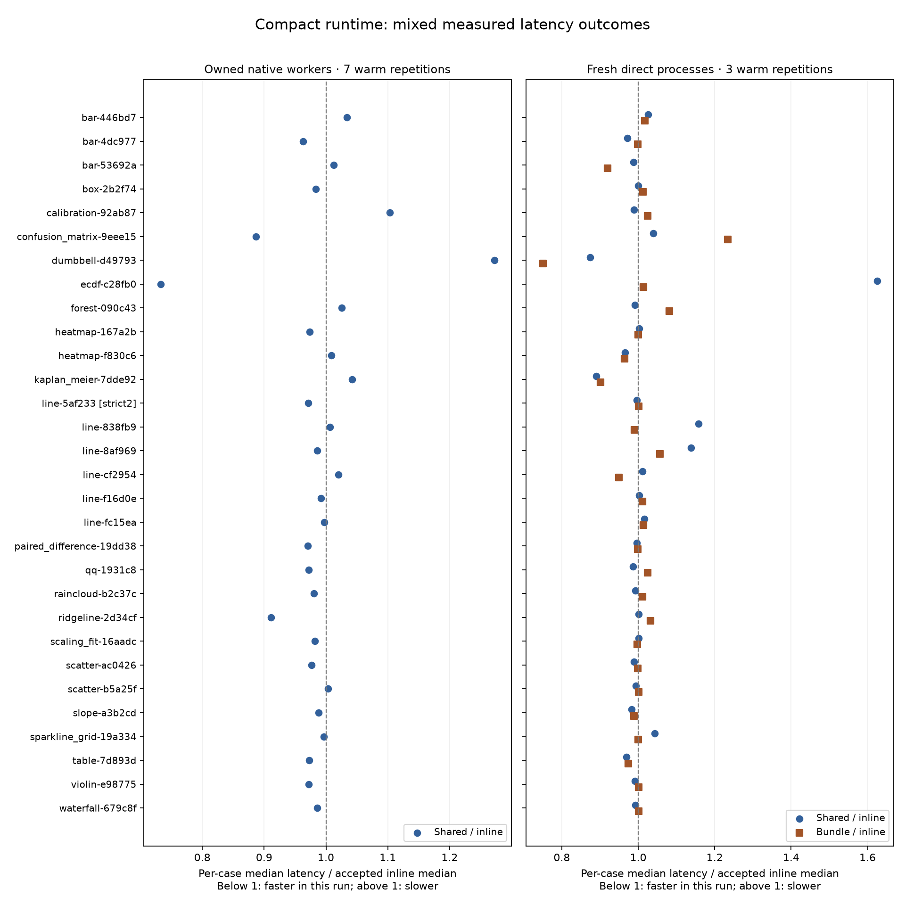

# Compact runtime measurement v1

Smaller entries preserve the original results; measured latency is mixed.
The same30 frozen variants span all21 kinds and retain their original strict failures.
This is a developer-controlled comparison on one Mac, not human authoring time or independent execution.

| Actual measure | Accepted inline | Default shared |
| --- | ---: | ---: |
| Median entry bytes | 118,491.5 | 33,256.5 |
| Median entry UTF-8 lines | 1,331.5 | 733.5 |
| Complete package-source/resource bytes | 1,828,626 | 1,897,739 |
| Complete package-source/resource files | 60 | 64 |

Native shared case medians are faster in 20/30 cases and slower in 10/30.
Direct shared case medians are faster in 17/30 and slower in 13/30;
standalone bundles are faster in 13/30 and slower in 17/30.
These counts do not establish a general speed advantage. All slower cases are retained.



The [150-row per-case CSV](case-summary.csv) gives every native/direct arm's warm median, linear-interpolated P90, repetition count and first-start time.
[Ratios](case-ratios.json) retain all30 exact comparisons. Never pool these as human time to a verified figure.

## Conditions and complete evidence

- Frozen [protocol](../../protocol.json): `befa743969611f0dabd46a29ca5d603acf7df8dcff5aa1e7b227179f2c495e91`; accepted baseline1b.
- Formal900 actual executions:870 strict0 and30 original strict2, zero unexpected failures/unrun;840 ordinary/cold timed and60 separate instrumented samples.
- Smoke360:348 strict0/12 original strict2, zero unexpected failures/unrun;300 ordinary/cold timed and60 instrumented samples.
- Per case/native arm: fresh owned context/font directory,16 renderer/64 compiler budgets,64-entry/32MiB numerical cache, one cold-font/seven warm/one extra instrumented original; alternate arm order per case.
- Direct arms: fresh process for each run, one cold-font/three warm; rotate arm order. Original source/true main guards execute through the same disclosed bootstrap. Launch-to-child-entry, bootstrap setup, original execution and completion/teardown remain separate raw fields. Wall time includes this harness.
- Exact actual Node binary matches native arms. Python interpreter binary and6,980 installed library/resource files across11 declared scientific distributions match between native/direct environments; only installed GraphUnslopify metadata deliberately differs. Bundled runs have no installed/importable package before launch and an invalid Node override.
- Actual report mathematics, identifiers/units/seeded uncertainty, strict policy, PNG pixels, SVG/PDF drawing content and native maps match accepted originals. Log contents match; actual script/component/provenance hashes are checked before normalizing source identity.
- Complete runtime/package/bundle bytes, UTF-8 lines and per-file hashes are in [formal raw measurements](formal-results.json). Eleven pinned scientific components are distinct from the full64-file shipped runtime; they are not a minimal dependency closure. Bundles contain source/input/spec/runtime; third-party scientific packages and optional external tools remain external.
- Read/compile/real C-exec hooks run only in the extra untimed native sample, against original program bytes, and restore before rendering. Ordinary samples have no hooks. Source-read/compile/exec diagnostic timings include observer overhead.

Small samples, one host and non-randomized alternating/rotating order limit performance inference; OS background activity and CPU frequency are not controlled. Repeated identical figures exercise the already-enabled numerical cache. No blind layout scores, outside researchers, new release or general Matplotlib advantage is measured here. Original reference/NIST protocols remain unchanged.

## Reproduce the measurement

Use the actual matching scientific versions in formal-results.json and a second Python environment without GraphUnslopify. The executable must retain its venv path. From the source checkout:

```sh
python scripts/runtime-benchmark.py --smoke --python /path/to/no-package/bin/python --out-dir /outside/checkout/smoke
python scripts/runtime-benchmark.py --python /path/to/no-package/bin/python --out-dir /outside/checkout/formal
```

Run serially without other project checks. The native geometry guard retains the frozen baseline's actual drawing conditions; different platforms/library/font versions may correctly refuse comparison. Setup/probes/translation/archive creation/extraction are recorded separately. All raw outputs, original programs, inputs, reports/maps, archives, complete source and actual harness versions are retained in the ZIPs listed in [verification](verification.json). Initial six one-case diagnostic probes predate full harness snapshots and are excluded from formal/smoke denominators. The intentional wrong-reference diagnostic fails as expected while retaining its real successful process duration. Required local gates and exact-commit CI are separate delivery checks.


## Local delivery checks

All seven required repository checks, gallery and both complete CI Ruff commands
pass: 232 Node tests, 1,929 Python tests, zero skips and one retained upstream
SQLAlchemy warning. All 838 protected source/config/data/golden paths stay unchanged
through all checks. [Gate receipts](local-checks-verification.json) and the tested
manifest bind those bytes; exact-commit GitHub CI remains a separate requirement.
Earlier interrupted, disk-full and transient-fixture attempts remain in the failure
archives. No tests or assertions were removed; the final retry uses a fresh private
pytest temporary base. All 52 existing README graphic placements remain unchanged.
