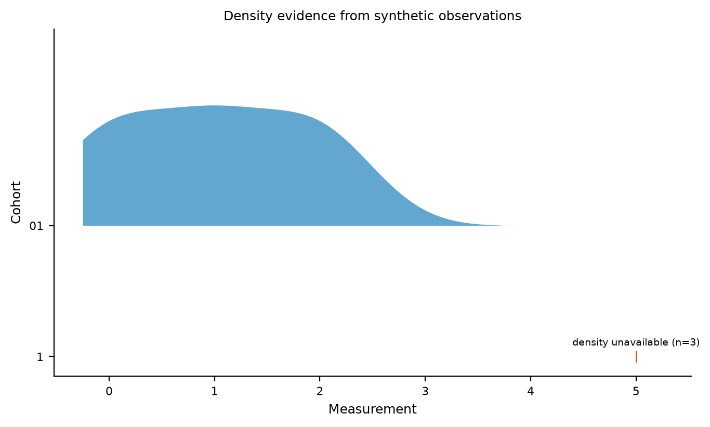

# Ridgeline density evidence

Ridgelines retain finite observations when the automatic density cannot be estimated.
A singleton or constant sample shows observation marks and visible `density unavailable`
context. Its report records the reason, finite/nonfinite counts and unknown bandwidth;
strict execution returns `incomplete` (exit2) while keeping exports. Constant5/5/5 previously
produced an empty0..1 axis with a clean strict report. Repeated decimal values such as0.05
are recognized as constant before floating-point variance noise can invent a tiny bandwidth.

For finite nondegenerate samples, the established Gaussian KDE uses:

```
h = 0.9 * min(sample_sd, IQR / 1.349) * n**(-0.2)
```

A zero IQR falls back to a positive sample standard deviation. No positive bandwidth is
invented for a constant sample. The normal-IQR constant1.349 is documented by [R's IQR
reference](https://www.stat.math.ethz.ch/R-manual/R-patched/library/stats/html/IQR.html).
This is an explicit robust normal-reference variant, not exact parity with [R's bw.nrd0](https://www.stat.math.ethz.ch/R-manual/R-devel/library/stats/help/bw.nrd.html),
which documents1.34 and different coincident-quartile fallback behavior. Bandwidth selection
is an assumption about smoothing; it does not establish the population distribution.

Each available profile is scaled to its **own peak**, with maximum height0.92 of a row
pitch. Heights/areas do not compare sample counts or probability masses between rows.
Evaluation uses256 points over the retained finite domain plus5% padding; displayed tails
are limited to that grid. Bandwidths are recorded in input measurement units. Percentage
observation descriptions match percentage axes. Counts are observations, not proof of
independent experiments. These rules describe ridgelines; violin/raincloud use their own
Matplotlib behavior and need separate reference evidence.

One pure profile plan supplies actual curves, point fallbacks and descriptions. Reports
scope density records by panel/metric/category. Nonfinite values are excluded and counted;
an observed category with no finite values stays unavailable. A reserved unobserved shared
category is a blank slot. Entirely nonfinite or unrepresentable domains fail clearly.
Unavailable density arrays stay unknown rather than becoming zeros.

`python/tests/test_density_references.py` has25 hand/SciPy/artist/domain/scoped/runtime/
provenance controls, including affine units and zero-IQR behavior. The initial17 controls
measured16 failures/one existing SciPy agreement before the fix. The independent
[SciPy Gaussian KDE](https://docs.scipy.org/doc/scipy/reference/generated/scipy.stats.gaussian_kde.html)
reference uses the same explicitly supplied bandwidth, rather than silently comparing two
software defaults. Existing shared-category controls remain green. The fresh offline wheel
checks a valid profile and actual retained points/labels for an unavailable density.



Inputs are committed in `examples/references/density.figure.json` and explicit-LF `density.csv`.
The example intentionally returns strict incomplete; it is a public negative control, not a
clean gallery entry. Its source/data fingerprints are checked. This is focused density
coverage; the full21-kind numerical/domain matrix remains separate.
