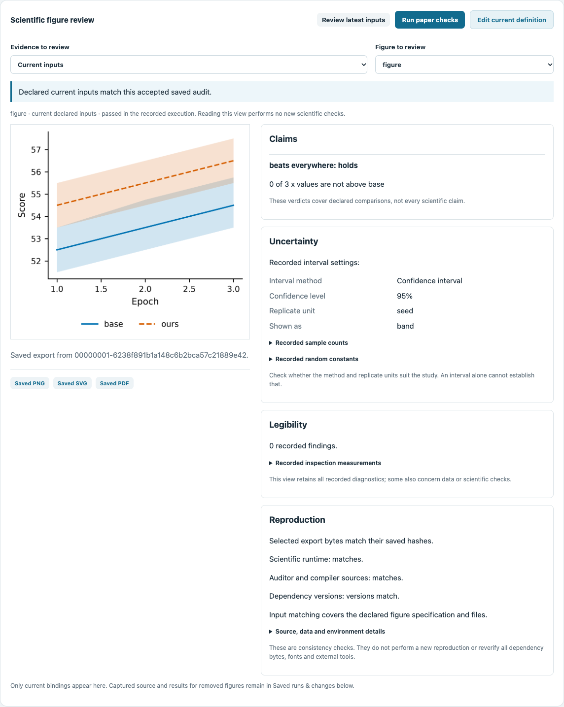

# Scientific figure review

Current source after **0.8.0** provides a connected review panel and read-only query for an existing
[paper project](project-management.md). Install from source; the published 0.8.0
wheel predates these interfaces.

## Open the review panel

Initialize a [paper project](project-management.md), then run:

```sh
graphunslopify project-preview paper --open
```

**Scientific figure review** sits above the original definition controls. Choose
a current figure and inspect its actual saved preview beside Claims, Uncertainty,
Legibility and Reproduction. **Edit current definition** opens the existing
canonical controls; **Run paper checks** executes the real strict paper audit.

**Current inputs** checks whether declared inputs, selected exports and known
source/runtime/version evidence still match. An unsaved draft hides the current
preview and downloads. Select a **Saved** audit to read its original results; the
view keeps it labeled as historical, including failures while current inputs
match a different accepted run. Late responses cannot replace a newer selection.
Normal polling detects changed and restored export bytes, including when the
input revision stays the same. Changed exports hide the preview/downloads even
if the enclosing history receipt is intact. Unchanged background review reads
preserve open evidence details. File download routes independently verify the bytes again.

Only current bindings appear in the panel. **Saved runs & changes** below retains
captured source, removed bindings, actual exports and before/after comparisons.
If the manifest is unreadable or a state request fails, the panel clears cached
acceptance, previews and downloads until a successful read restores the evidence.
Reading either view does not rerun science or repair its findings.



## Read the same evidence from the CLI

```sh
graphunslopify project-review paper
graphunslopify project-review paper --event EVENT_ID
```

Use an actual event ID from `graphunslopify project-history paper`. Without
`--event`, the query selects the latest run or a newer incomplete/damaged event.
It does not silently fall back to an older success. An explicit historical
selection retains its original results and cannot borrow current acceptance.

Each current figure connects four groups of saved evidence:

| Group | What it shows | Limit |
|---|---|---|
| Claims | Actual declared comparison verdicts (`holds`, `fails`, or untested) | Does not establish undeclared scientific claims |
| Uncertainty | Declared method, aggregation, sample counts and random constants | Showing an interval does not establish that its method suits the study |
| Legibility | Recorded inspection and findings, with existing diagnostic advice | Reading the query performs no new inspection |
| Reproduction | Recorded source/data/runtime/environment, current declared input freshness and independently checked selected exports | No new execution or cross-machine reproduction |

The command does not execute scripts, repair inputs, change history or grant
scientific acceptance. Exit 0 and `query_status: "ok"` mean the evidence was read;
the scientific results can still fail. Use an explicit `project-run` to rerun.
Missing, damaged or never-executed evidence stays unavailable. The figure list
describes the current project; use the existing history commands for removed
bindings. Recorded input coverage comes from the selected run’s
snapshot; current declared coverage is reported separately.

`matches_latest_accepted_inputs` describes strict accepted evidence for unchanged
declared inputs. `rerun_recommended` also considers the recorded runtime,
auditor/compiler sources and installed dependency versions. Authored Python
always recommends a rerun: one declared data path cannot establish every import
or external input used by arbitrary code. No field promises universal scientific
correctness.

New project runs record a hash inventory of actual package Python, compiler and
schema sources and fail if these change during execution. Package sources are
captured before importing the scientific/compiler modules; an upgrade during a
long-running session requires a restart before review or audit. Older runs
without this inventory remain readable, with source identity marked `not_recorded`. Version
matching does not reverify complete dependency bytes, system fonts or external
tools. Source hashes are consistency evidence, not author authentication.

History receipts cover their listed source/result/aggregate files. Selected
export bytes receive a separate size/SHA check, including explicit old selections;
an intact receipt alone cannot establish that a PNG is unchanged.

The existing loopback server exposes the same envelope at session-protected
`GET /api/review`, optionally `?event=EVENT_ID`. It shares the paper workspace's
token and ownership rules. A concurrent change to inputs/history or execution
sources rejects the query and asks for a refresh.

The connected browser panel and backend are foundations of Scientific Figure
Review Mode. Foreign/source-free figure review, reviewed batch changes and undo,
selective regeneration and auditable review export remain
tracked in `pipeline/specs/87-scientific-figure-review-mode.md`.
