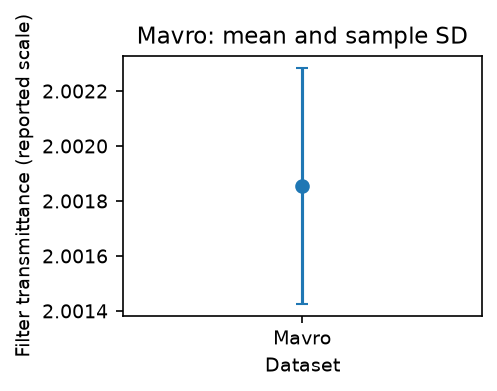
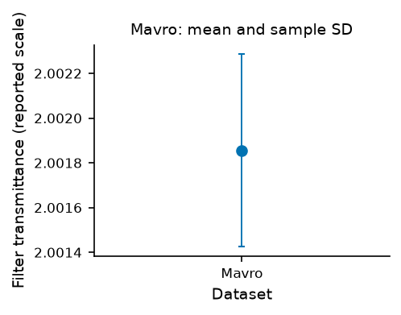
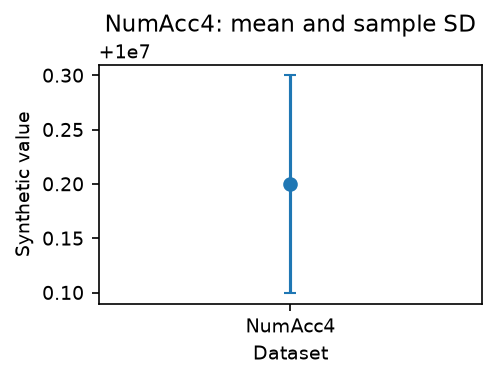
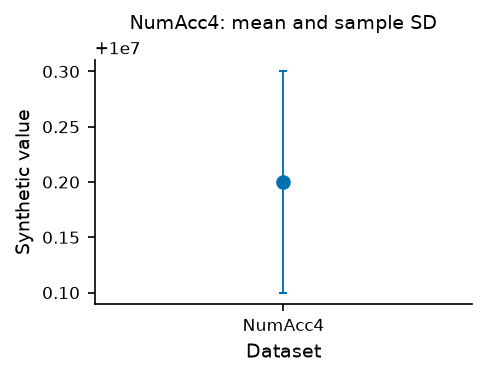

# Familiarized agent authoring-time study

Status 2026-10-29: **first pair complete; second reverse-order pair pending**.
Preregistration c98fc52 passed exact main40871787084 all9/Figure40871786787 before
any new clock. The same nine-dataset task/unchanged v2 gates remain frozen.

| Episode | Familiarized agent-task seconds | Accepted cases | Attempts |
| --- | ---: | ---: | ---: |
| Round1 GraphUnslopify | 21.744921709 | 9/9 | 1 |
| Round1 Matplotlib | 16.953347625 | 9/9 | 1 |

These are two observations from one already-familiar coding assistant. The
mandatory second pair remains unexecuted; no general productivity advantage or
complete four-episode result is claimed. All54 final export hashes/18 decoded
PNGs and source/runtime identities were reread; UTC/monotonic intervals agree
within0.001s. Both episodes ended before report/CI/vault work resumed.

[Raw session events](../../benchmarks/authoring/sessions.jsonl),
[first-pair audited summary](../../benchmarks/authoring/round1-summary.json),
[retained full attempts](../../benchmarks/authoring/development/).

The [NIST comparison](certified-benchmark.md) measured numerical errors,
reproducibility, machine timing and physical export proxies. Its first authoring
episodes cannot support a paired speed comparison: one included shared evaluator
repair and CI waiting. Keep those records and their invalid-timing flag.

This follow-up measures fresh reimplementation by one already-familiar coding
assistant, using the same complete nine-dataset task and unchanged NIST v2
verifier. It supplements the first episodes. It does not measure first-use human
learning, independent researchers or causal/general productivity gains.

[Prospective protocol](../../benchmarks/authoring/protocol.json),
[controller](../../benchmarks/authoring/session.py),
[measured preflight receipt](../../benchmarks/authoring/preflight.json).

| Round | First episode | Second episode |
| --- | --- | --- |
| 1 | GraphUnslopify | Matplotlib |
| 2 | Matplotlib | GraphUnslopify |

All four are required regardless of which workflow is faster. Each new producer
starts absent, reads all observations, and implements nine mean/sample-SD figures
with the existing labels, PNG/SVG/PDF exports, numerical allowances, physical-size
checks and exact finalized-file retention. Producers may use documentation/library
APIs and remembered patterns; do not copy an existing producer file or use an
arm-specific prepared generator. The same CSV/statistics/Matplotlib alternative
and real local GraphUnslopify compiler remain the compared workflows.

## Clock and retained evidence

A live UTC/monotonic begin precedes further producer-specific lookup/writing.
A matching machine-boot identity, interpreter/platform, dependency versions and
shared runtime fingerprints must remain stable. A failed subject attempt keeps
the original clock running. All nine cases must verify before it ends; partial,
duplicate, reordered or source-unbound results cannot end an episode. Actual
source snapshots, full case reports and every attempt remain retained.

Format/lint the new source inside its episode before successful verification;
changing it afterward would invalidate its recorded source hash. Finish episodes
before doing CI, documentation, vault maintenance or unrelated work. Disclose
interruptions/shared-harness repairs as confounds without resetting the clock.
Prior shared preparation/familiarity/CI outside episodes is excluded and
unmeasured. Report that cost separately from authored/payload/generated code size.

The source manifest, nine-dataset selection, mean/sample-SD task and existing v2
numeric/physical/export rules remain unchanged. The authoring protocol additionally
binds its controller/CLI/runner implementation hashes. Do not change those files
after clocks start; a changed study needs explicit retained/versioned evidence.
A new producer-path argument lets the existing case worker assess each fresh
implementation without replacing either original producer or its earlier results.

## Run from an editable checkout

Install the checkout with `python -m pip install -e ./python`. Prepare the pinned
public inputs using [the existing source guide](certified-reference.md). Select
fresh output directories throughout:

```sh
python scripts/authoring-benchmark.py --preflight --out-dir benchmarks/authoring/.cache/preflight-new
python scripts/authoring-benchmark.py --begin
# Write only the newly named producer from the begin response, then lint/format it.
python scripts/authoring-benchmark.py --attempt --out-dir benchmarks/authoring/.cache/round1-graph-attempt1
```

Begin returns the next declared episode/source path. On failure, retain that
output, fix the subject producer and invoke another `--attempt` with a fresh
output path. On success its end event is appended to
`benchmarks/authoring/sessions.jsonl`; only then begin the next declared episode.
The generic driver never writes the arm-specific producer for the operator.
Raw/derived source observations stay in the ignored persistent cache; Git and CI
artifacts contain metadata, source programs and our generated plots.

## Preflight evidence

Both existing canonical producers passed all nine datasets through the new
producer-path route: 18 runs/54 final PNG/SVG/PDF exports. This is validation of
shared machinery before authoring clocks, not four completed implementation
sessions. Full local reports are retained in the ignored
`benchmarks/authoring/.cache/preflight-final/`; the committed receipt records their
hashes, original producer hashes and the unchanged v2 verifier identity.
CI repeats the actual 18-case preflight and uploads its complete artifacts.

Clock guards and a real synthetic producer/PNG/SVG/PDF test cover restart,
clock-origin/protocol/runtime mutation, partial/duplicate/reordered success,
changed-source retention and preservation of failed attempts. Current results
and exact pushed CI are recorded in the project knowledge and implementation spec.

## Reporting limits

Retain all four elapsed times, the two pairings and any failures rather than
stopping on a favorable result. Both tools have already been studied by this
assistant; the order is balanced across pairs but there are no independent
subjects or blinded judgments. Warm caches and tool latency are part of the
recorded conditions. A completed unamended study would support these bounded
agent-task observations; it would not establish human productivity or adoption.
Numerical/physical proxies do not substitute for human aesthetic ratings.


## Replay completed implementations

```sh
python scripts/replay-authoring.py --out-dir benchmarks/authoring/.cache/replay-new
```

The replay verifies historical event/report/producer identities and runs every
completed producer through all nine original tasks without creating new clocks.
Historical authoring seconds remain historical values. A partial completed prefix
can pass replay while `study_complete` remains false; it does not finish the
mandatory four episodes. CI retains actual replay outputs alongside preflight
artifacts. This separate postprocessing script changes no frozen acceptance code.


## First-pair original exports

Unmodified actual PNGs; Mavro is observed filter transmittance, NumAcc4 is a
generated numerical challenge. Selected Mavro Matplotlib and NumAcc4 Graph images
were visually inspected; the1e7 offset means the displayed0.2 is10000000.2.

| Case | Matplotlib | GraphUnslopify |
| --- | --- | --- |
| Mavro |  |  |
| NumAcc4 |  |  |
