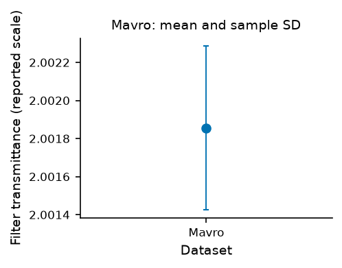
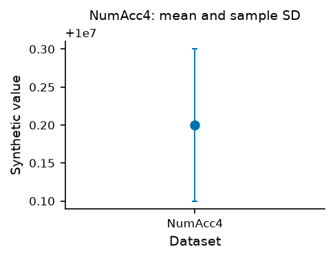

# NIST reference comparison: measured results

Both validated workflows produced faithful mean/sample-SD figures on all nine
NIST reference datasets. Both external validators rejected the deliberately
missing intervals. This run establishes numerical/engineering behavior within
the frozen workload; it shows no unique error-detection or throughput advantage
for GraphUnslopify over the validated Matplotlib alternative.

Measured 2026-10-29 on macOS arm64, Python 3.12.14, NumPy 2.5.4, pandas 3.1.0,
Matplotlib 3.11.2, Pillow 13.0.0 and pypdf 6.21.2. The source run uses 5a76ed1 and
[protocol v2](../../benchmarks/certified/protocol.json), fully CI-verified before
formal execution. Source/producer hashes identify actual code; the recorded dirty
Git state reflects task-journal/results artifacts, with numerical/runtime source
maps independently checked unchanged after the run. Public PyPI 0.8.0 is unchanged.

[Full measured report](../../benchmarks/certified/results/report.json),
[compact summary](../../benchmarks/certified/results/summary.json),
[72-row run metadata](../../benchmarks/certified/results/runs.csv),
[input/protocol history](certified-reference.md),
[NIST collection](https://www.itl.nist.gov/div898/strd/univ/homepage.html).
The CSV contains run results, not source observations.

## Outcomes

| Measure | Matplotlib + external verifier | GraphUnslopify + external verifier |
| --- | ---: | ---: |
| Clean figure runs accepted | 18/18 | 18/18 |
| Drawn values measured per quantity (mean/low/high/half-span) | 54/54 | 54/54 |
| Deliberately missing intervals correctly rejected | 18/18 | 18/18 |
| Runtime execution failures | 0 | 0 |
| Clean PNG repetition pairs identical | 9/9 | 9/9 |
| All PNG repetition pairs identical | 18/18 | 18/18 |
| Clean runs passing export/physical/visibility proxies | 18/18 | 18/18 |
| Smallest measured text at 3.4in target width | 9.24pt | 8.02pt |
| Text-overlap candidates in measured exports | 0 | 0 |

Each arm has nine datasets, two conditions and two repetitions:36 runs. Each
clean run writes PNG/SVG/PDF, giving 54 observed values per quantity; these are
repeated exports, not 54 independent datasets. All 36 repetition pairs agree in
outcome and decoded PNG pixels. Reproducibility includes deliberately incomplete
figures, so it is recorded separately from task acceptance.

A separate publication audit rereads all 216 final file hashes and decodes all 72
actual PNGs. Original raw/CSV tokens, producer versions and installed/runtime
source maps also remain unchanged. Missing/changed artifacts cannot pass.

The missing-interval sentinel is an authored request that intentionally omits SD.
GraphUnslopify's native reports pass that requested spec; the external verifier
knows the study required an interval and rejects the resulting figure. These are
external-task catches in both arms, not 18 native GraphUnslopify catches or errors
alleged in NIST's original work. A strict run can satisfy a mis-specified request.

## Numerical deviations

Maximum absolute plotted-mean error across the two repeats/three exports, in
each dataset's supplied units:

| Dataset | Matplotlib | GraphUnslopify |
| --- | ---: | ---: |
| PiDigits | 2.8e-16 | 2.8e-16 |
| Lottery | 3.08e-13 | 3.08e-13 |
| Lew | 2.27e-15 | 2.27e-15 |
| Mavro | 7.98e-17 | 3.64e-16 |
| Michelso | 1.13e-14 | 1.13e-14 |
| NumAcc1 | 0 | 0 |
| NumAcc2 | 4.44e-17 | 4.44e-17 |
| NumAcc3 | 4.66e-11 | 6.98e-11 |
| NumAcc4 | 7.45e-10 | 1.12e-09 |

All means, endpoints and derived half-spans meet the predeclared reference-
precision/input-float/coordinate-ULP allowances. Full per-value deviations and
allowances remain in the report. Absolute errors from different physical units
must not be pooled into a scientific accuracy ranking.

The largest endpoint error is 2.61e-9 and the largest inferred half-span error is
1.49e-9, at coordinates near 1e7. Subtracting large plotted endpoints loses digits;
that is not a measurement of the underlying SD estimator's full precision. The
certified answers are external NIST facts; this is no NIST endorsement/certification
of the software, whole-StRD coverage or validation of experimental independence.

## Machine timings and implementation evidence

Median seconds over 18 clean runs per arm, fresh processes with warm shared caches:

| Stage | Matplotlib | GraphUnslopify |
| --- | ---: | ---: |
| Producer/build process | 0.0155 | 0.1556 |
| Figure worker process wall time | 0.2708 | 0.4181 |
| Instrumented script execution | 0.0978 | 0.2298 |
| File-save calls | 0.0649 | 0.0672 |

Stages overlap/nest and must not be added indiscriminately. Measurement overhead
is included; the worker process also includes imports/decoding. GraphUnslopify
performs translation, runtime inspection and provenance work absent from the
plain plotting program. These machine observations are specific to this host,
versions and task, and do not measure human development time.

Authored reusable producers have 60/77 nonblank lines (Matplotlib/GraphUnslopify).
Median generated programs have 25/825 nonblank lines, and serialized parameter
payloads 437/618 bytes. Matplotlib's payload is plotting configuration;
GraphUnslopify's is a FigureSpec with a presentation-coordinate adapter. Generated
code size is output footprint, not authored effort. Selected shared runtime
helpers total 1595 nonblank lines; prior shared preparation/design time is
unmeasured and excluded. The exact files/sizes/hashes are in the summary.

Initial live implementation episodes record 42.1885s for Matplotlib and 3171.1415s
for GraphUnslopify. The latter includes shared SVG-evaluator debugging/repair and
CI waiting, explicitly flagged invalid for a paired authoring-speed inference.
One familiar, unblinded coding assistant and fixed order also cannot establish
human productivity. Earlier failures, the protocol amendment and all clocks
remain in [the session log](../../benchmarks/certified/development-sessions.jsonl)
and [development reports](../../benchmarks/certified/development/). A clean paired
authoring-time estimate remains unmeasured; no authoring advantage is claimed
from these contaminated episodes.

## Actual representative exports

Mavro is an observed filter-transmittance dataset; NumAcc4 is a generated numerical
challenge. These are the unchanged repeat 0 clean PNGs, independently checked
against the report. Both pairs were visually inspected. The NumAcc4 axis uses an
additive 1e7 offset; the displayed 0.2 corresponds to 10000000.2.

| Dataset | Matplotlib | GraphUnslopify |
| --- | --- | --- |
| Mavro |  |  |
| NumAcc4 |  |  |

The physical-size/export proxies and selected visual review do not establish
blinded aesthetic quality, researcher usefulness or adoption. Vector formats are
available; 150dpi raster output is the declared preview condition, not a blanket
journal-submission recommendation.

## Reproduce and retain

From an editable development checkout, prepare the pinned inputs as documented
in [the source guide](certified-reference.md), then choose fresh output folders:

```sh
python scripts/certified-benchmark.py --out-dir benchmarks/certified/.cache/comparison-new
python scripts/publish-certified-results.py --report benchmarks/certified/.cache/comparison-new/results.json --out-dir benchmarks/certified/.cache/publication-new
```

The publisher independently verifies actual files and creates report/summary/CSV/
selected-copy artifacts without rerendering. Source observations stay in the
ignored cache and are not uploaded. CI runs the complete comparison after explicit
pinned preparation and retains actual outputs/logs plus publication evidence.

This is project-authored evaluation against independent reference answers.
Human researcher sessions remain deferred at the user's request. Neither public
reference data nor another automated code audit substitutes for external adoption
feedback. The broader researcher-readiness assessment remains unmeasured.
