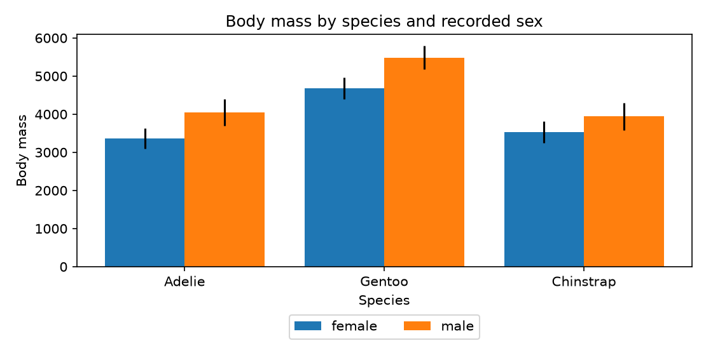
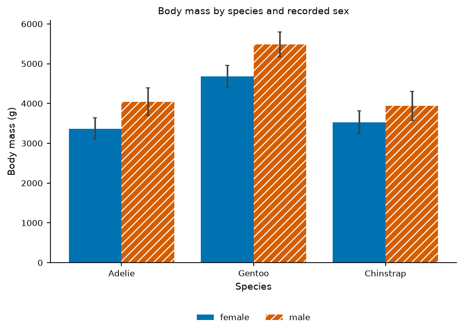
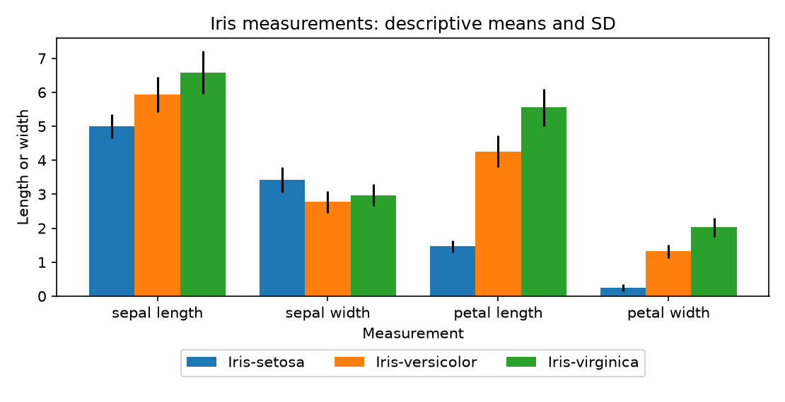
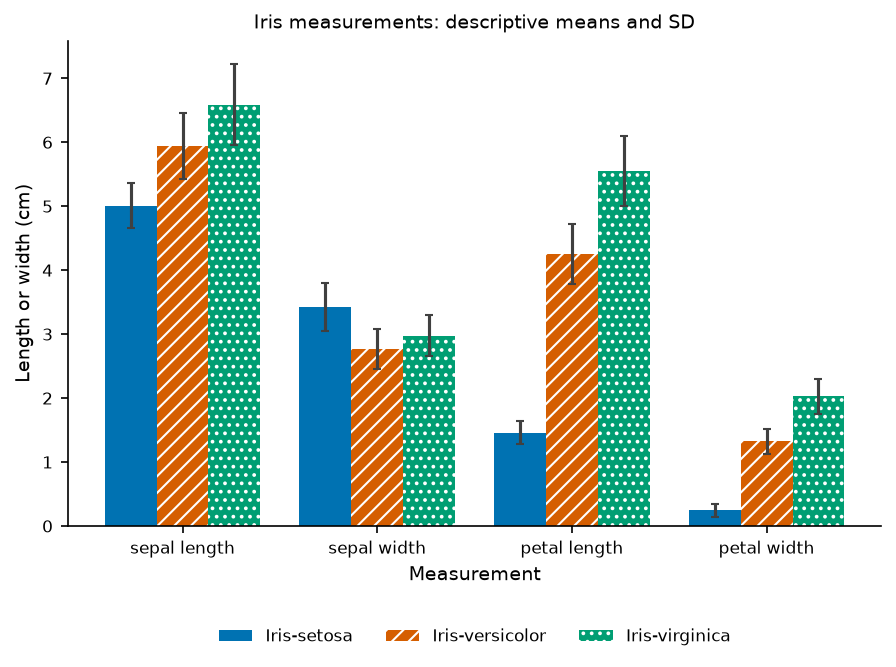
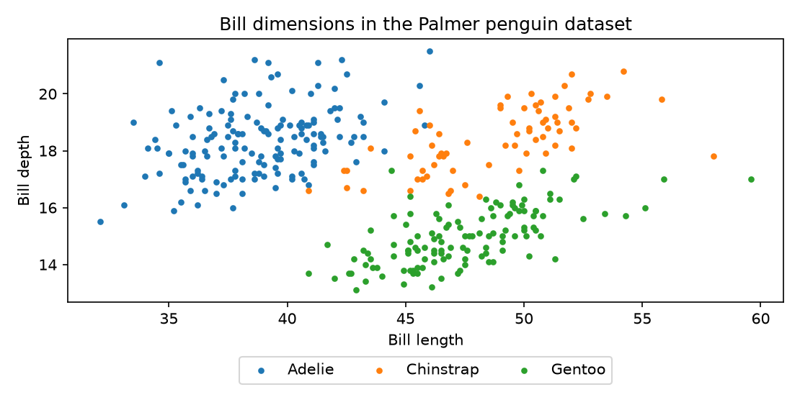
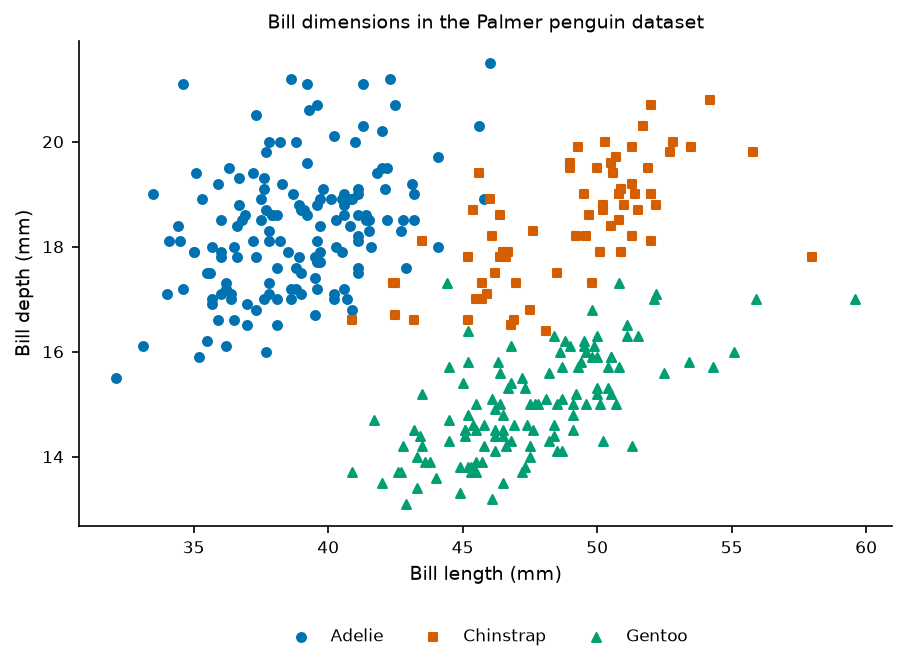
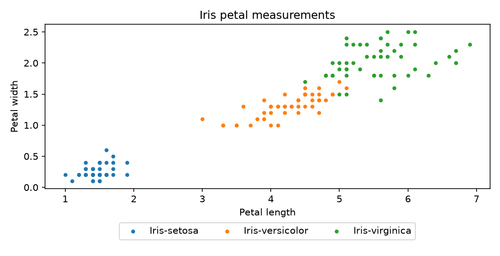
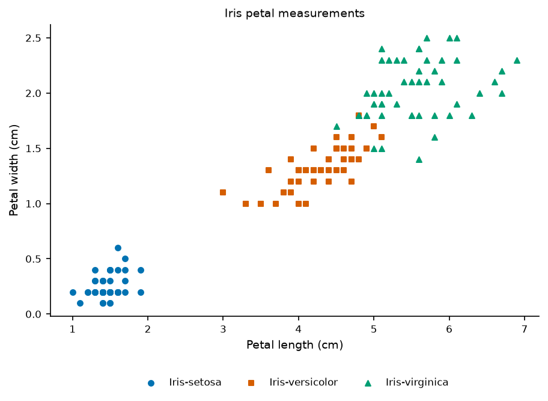

# Test against published papers and public data

At the user's request, volunteer testing is deferred. These examples test the
existing tool on two real, publicly available research datasets. They are
**author-run descriptive reproductions and deliberately seeded faults**, not
full replication of either paper, independent external validation or evidence
of researcher adoption. The separate [synthetic pilot](benchmark.md) remains available.

## Sources and scope

| Paper/data | Pinned input | What is reproduced |
| --- | --- | --- |
| [Gorman, Williams & Fraser (2014), PLoS ONE](https://doi.org/10.1371/journal.pone.0090081), via [palmerpenguins](https://allisonhorst.github.io/palmerpenguins/) | 344 observations, CC0, immutable upstream commit | Published species counts152/68/124; descriptive body-mass means/SD by recorded sex; bill-dimension scatter. The paper's GLM/PCA/model averaging is not rerun. |
| [Fisher (1936)](https://doi.org/10.1111/j.1469-1809.1936.tb02137.x), [UCI Iris](https://archive.ics.uci.edu/dataset/53/iris) | 150 observations, CC BY4.0, corrected `bezdekIris.data` | Published class counts50/50/50; descriptive means/SD for four measurements and petal scatter. The original discriminant analysis is not rerun. |

The [dataset notices](../../benchmarks/papers/NOTICE.md) and
[source manifest](../../benchmarks/papers/sources.json) record attribution,
licenses, retrieval date, download URLs and exact hashes. Data are vendored so
the tests run without downloading datasets. The UCI archive includes both an
original and a corrected file; rows35/38 differ. Both are retained, and examples
consistently use the corrected one. No measurement values are silently repaired.

Penguin body-mass comparisons explicitly filter recorded sex to female/male,
leaving333 observations. The scatter uses342 finite pairs from344 source rows.
Iris's150 observations reshape into600 measurement rows; that is still50 plants
per species/measurement, not600 independent plants. SD describes observed
spread. These plots do not establish independent sampling, confidence in a
population effect, causality or the papers' broader scientific conclusions.

## Run it locally

```sh
python -m pip install -e ./python
python scripts/prepare-paper-data.py
python scripts/paper-benchmark.py --out-dir /path/to/empty/paper-evidence
graphunslopify audit examples/published-papers --out-dir /path/to/paper-audit
```

The preparer verifies source hashes and published class counts, then creates
deterministic headered/long Iris views. It refuses to overwrite a changed view;
inspect differences before explicitly removing/rebuilding one. The benchmark
requires a fresh output directory and this checkout's editable package. It
records harness/input and actual installed implementation hashes and confirms
the latter does not change during execution.

The [four figure specs and paper manifest](../../examples/published-papers/)
can also be rendered/audited through the ordinary CLI. Each figure gets PNG,
SVG, PDF, generated Python and a strict runtime report. Benchmark evidence
retains specs, reference renders, stdout/stderr and generated scripts. CI's
`published-papers` job reruns the benchmark and uploads its actual evidence.

## Measured comparison

The [committed result snapshot](../../benchmarks/papers/results.json) contains
32 workflow executions:8 cases ×2 workflows ×2 repeats. The ordinary Matplotlib
workflow uses separately written `csv`/`statistics` calculations, not pandas or
GraphUnslopify. Its actual bars/error segments and scatter offsets are measured.
The generated product script's actual artists are measured against the same
reference, preserving category/group identity and missing interval endpoints.
Scatter truth comes directly from finite source CSV observations, separately
from either renderer's extracted artists, so a shared extraction omission fails.

| Positive example | Observations/estimates checked | Largest product numeric deviation |
| --- | --- | --- |
| Penguin body mass | 333 observations,6 means and SD bounds | <5×10⁻¹³g |
| Iris measurements | 150 plants,12 means and SD bounds | <10⁻¹⁵cm |
| Penguin bill scatter | 342 visible coordinate pairs | 0 |
| Iris petal scatter | 150 visible coordinate pairs | 0 |

Both workflows pass all four positive cases. Two injected false comparisons
are rejected: female body mass above male in every species, and virginica above
setosa on **all four** Iris measurements (setosa has greater mean sepal width).
An absent penguin reference and a one-observation-per-cell SD request both
remain incomplete and are blocked. These faults are ours; they are not
allegations about errors in the papers. Both workflows catch the same faults.
All8 case pairs reproduce decoded PNG pixels within each workflow/environment.
There is no claim of pixel equality between the two renderers or of time saved.

One initial measurement error was in this benchmark: Matplotlib retains masked
missing-data rows in scatter offsets. Counting those would falsely report344
visible points. The probe now excludes masked/nonfinite offsets and checks342
actual points; a focused regression protects this distinction.

## Inspect the figures

These are descriptive plots generated here, rather than copies of published
figures. Iris-derived images retain the dataset attribution above.

| Example | Ordinary Matplotlib with assertions | GraphUnslopify |
| --- | --- | --- |
| Penguin body mass |  |  |
| Iris measurements |  |  |
| Penguin bill dimensions |  |  |
| Iris petal dimensions |  |  |
