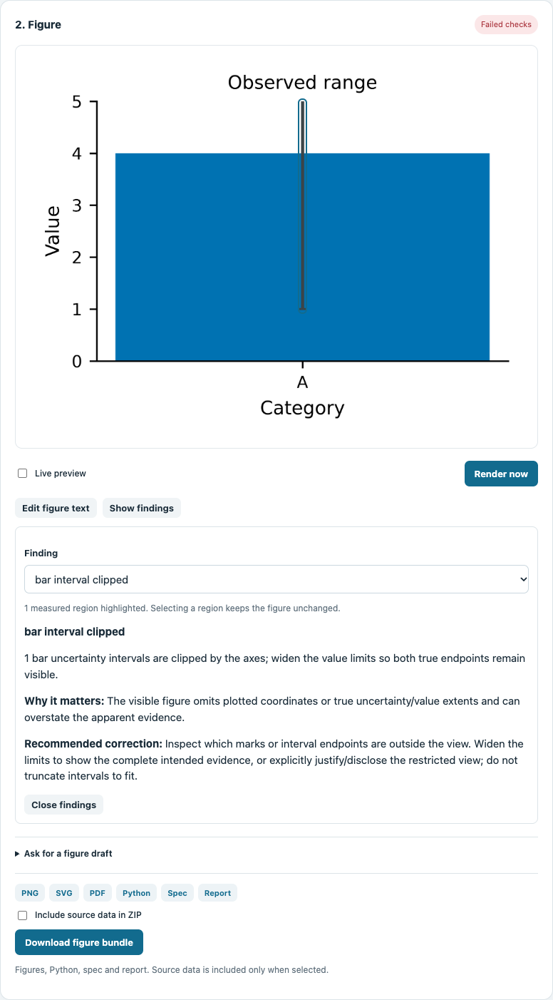

# Click a measured finding: checkpoint 83d

In the current-source editor, choose **Show findings**, click a highlighted region
or use **Locate on figure** on a finding card. The selected finding explains the
problem, its consequence and the recommended correction. The finding picker and
native buttons support keyboard selection; Escape closes the review.

This synthetic example remains **Failed checks**: the observed interval 1..9 is
clipped by authored limits 0..5. Selecting its visible stem opens the actual
`bar_interval_clipped` finding. Its original data, specification, rendering count,
failure status and availability of review artifacts stay unchanged. A downloadable
review bundle retains the actual runtime report; it does not certify a failed run.

## Bound to the current image

Highlights use [actual diagnostic geometry](diagnostic-geometry.md) from the final
cropped PNG. The browser checks the metadata version, actual image identity and
dimensions, run/spec ownership, supported primitive, finding index and finite
in-image bounds. Missing locations are explicit in the picker/cards. Partial
capture is disclosed; malformed metadata creates no targets.

Changing the specification or replacing data clears old targets immediately.
A held older response cannot revive them. The same image surface positions text
editing and diagnostic regions at narrow/wide/short viewport sizes. **Edit figure
text** and **Show findings** select separate interactions, preserving unapplied
wording when switching. Highlight borders use outlines so thin interval targets
retain their measured dimensions; their separate pointer area remains usable.

## Explicit repair and scientific status

When the verifier offers a patch, review **Review proposed change** and choose
**Apply fix**. That existing verifier-owned action now runs strict rendering even
with live preview off, and enters the normal undo history. Selection itself has
no repair or data-edit action.

The three-day and wider eight-year fixtures now verify after the offered temporal
scale repair, retaining their original three-row hashes. The renderer-owned
[date-label correction](date-label-layout.md) resolves the measured three-day
collision. A separate negative observation on an authored log value axis still
fails strict checks after repairing the time scale. Undo restores authored
intent and invalidates the repaired preview.

## Original83d checkpoint verification

`scripts/preview-diagnostics-check.ts` adds 17 real browser workflows: selection
without mutation/rendering, keyboard/card/narrow interaction, independent PNG
rectangle alignment within 1 CSS pixel, explicit unknown locations, text-mode
preservation, four malformed/stale metadata refusals, current-edit/data clearing,
held-response refusal, literal markup safety, partial-capture disclosure and
strict manual repair/undo. It is part of `npm run preview-check`.

Source and fresh offline installed browsers each pass all 83 workflows across
21 native kinds with zero JavaScript errors or external browser requests. The
diagnostic cases also pass with the actual minimum Python 3.10 runtime. Model
cases elsewhere in the suite use a controlled provider; these results establish
neither model quality nor human usability/productivity.

All seven required gates pass on stable source/test files: 234 Node/1637 Python,
zero skips/one existing upstream MLflow/SQLAlchemy warning. Gallery passes15/15;
19 installed assets match source and all75 prior tracked PNG bytes are unchanged.
Four new actual UI screenshots provide separate evidence. See
[verification](clickable-diagnostics/verification.json) and adjacent browser/asset
JSON. Exact7cc1f64 main41082692466 all9 and Figure41082692500 passed. Preceding 1859edb exact main 41075487244 all nine jobs and
Figure 41075487357 passed before this implementation. Remaining owned layout and
the full 84–89 roadmap stay open. Published 0.8.0 predates these source features.
