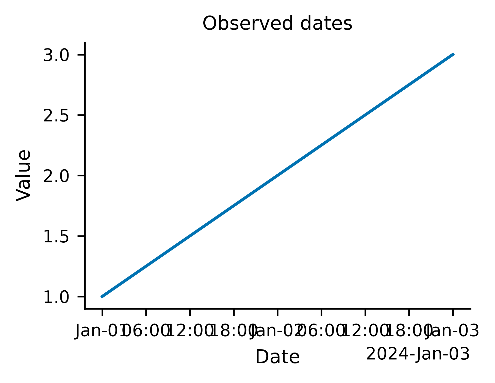
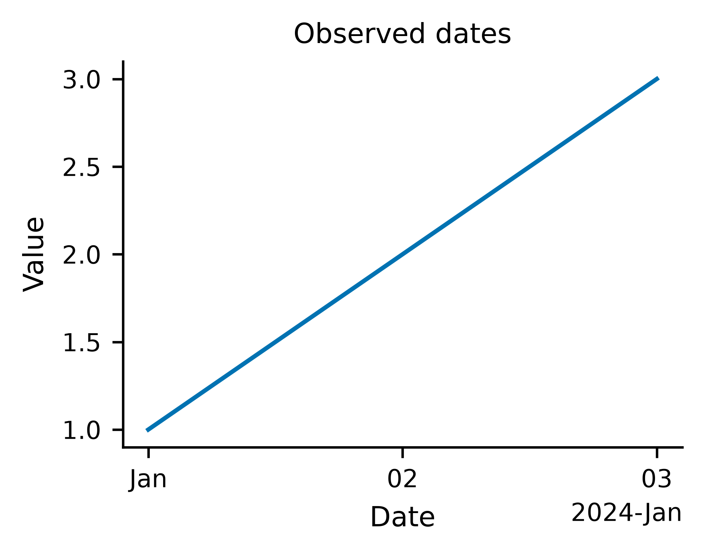

# Measured date labels: checkpoint83e1

A three-row daily time series previously rendered nine hourly labels into a
single-column figure. Strict inspection correctly rejected their overlap. The
renderer now measures visible native date ticks after layout and reduces their
locator density only when they actually collide. It also measures and separates
a date offset from its axis label when their boxes intersect. Fonts, observations,
authored value bounds, and the canonical specification stay unchanged. Fitting is
bounded; any unresolved collision remains subject to the original strict checks.

| Before: overlapping hourly ticks | After: readable calendar ticks |
| --- | --- |
|  |  |

The same synthetic CSV/specification was executed with the real translator from
7cc1f6494f12c4d843ca2231c5b7fbcc230687b3 and the current source. Before: exit2,
`tick_labels_collide`. After: exit0, no blocking findings. Both retain spec hash
`dbdaff03ef71112d` and data hash prefix `7496a63cb2f175b0`; the advisory
`line_implies_continuity` remains. [Inputs and measured reports](date-label-layout/measurements.json)
are stored beside these images. PNG, SVG and PDF were actually exported.

`python/tests/test_date_label_layout.py` checks actual strict output and native
artists for line/scatter, shared facets, repeated metrics and authored value
bounds; the uncrowded eight-year export retains its original RGBA pixels and
native locator. A separate negative log-domain observation still blocks strict
verification with exit2. Unsupported numeric bounds on a temporal axis remain
refused by the existing semantic guard.

The real browser repair/undo checks now expect the three-day dataset to verify
without changing its three original observations. A new independent negative
case verifies that repairing the time scale still leaves a log value axis hiding
a negative observation scientifically blocked. The original83d snapshots retain
their historical failure as evidence, rather than an expected current defect.

This addresses one measured owned-layout problem inside83. Long/nested headings,
long legend wording, full83 acceptance and84–89 remain open. These are source
changes after the published0.8.0 release; no release/tag is created here.

## Checkpoint verification

All seven required gates passed on unchanged source/test files:234 Node/1645
Python tests, zero skips/one existing upstream MLflow/SQLAlchemy warning. The
eight focused cases also pass on actual Python3.10 and the fresh installed wheel.
Source/fresh offline browsers pass84 workflows/21 kinds/18 diagnostic cases,
zero JavaScript errors/external browser requests; minimum-Python diagnostic18
also pass.19 installed assets byte-match source.

The translator was rebuilt; all15 baselines and7 reference programs were
genuinely regenerated with explicit Python. Gallery passes15/15. All79 prior
tracked PNGs retain identical RGBA pixels/dimensions; one temporal-gallery PNG
has new provenance bytes. [Verification](date-label-layout/verification.json)
and adjacent browser/asset/image JSON preserve the evidence. Exact new-commit
CI is required before advancing to the next layout change.
