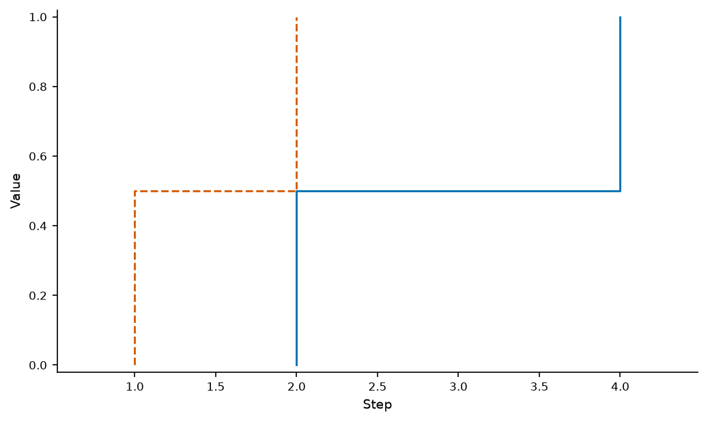
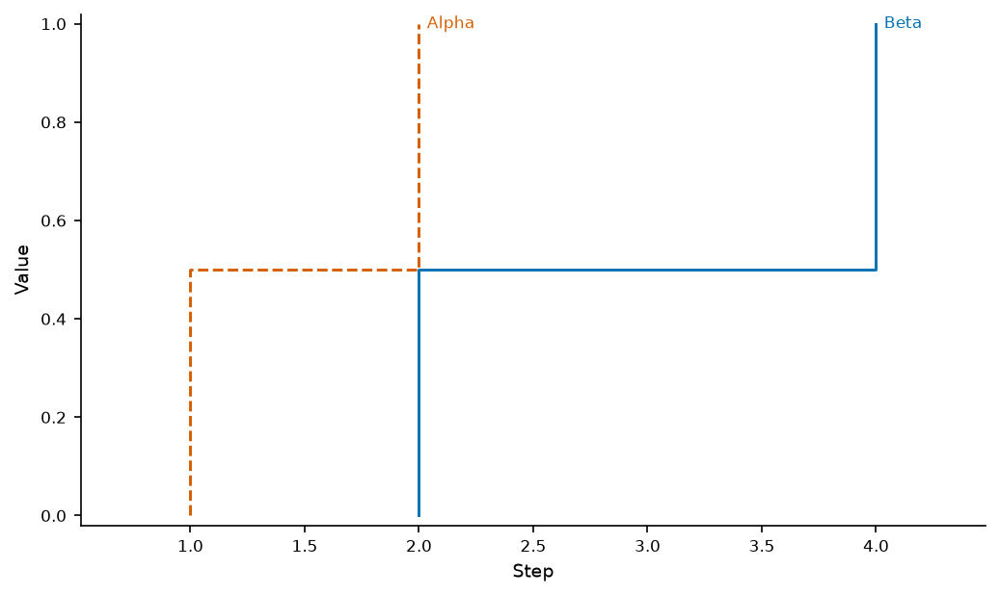
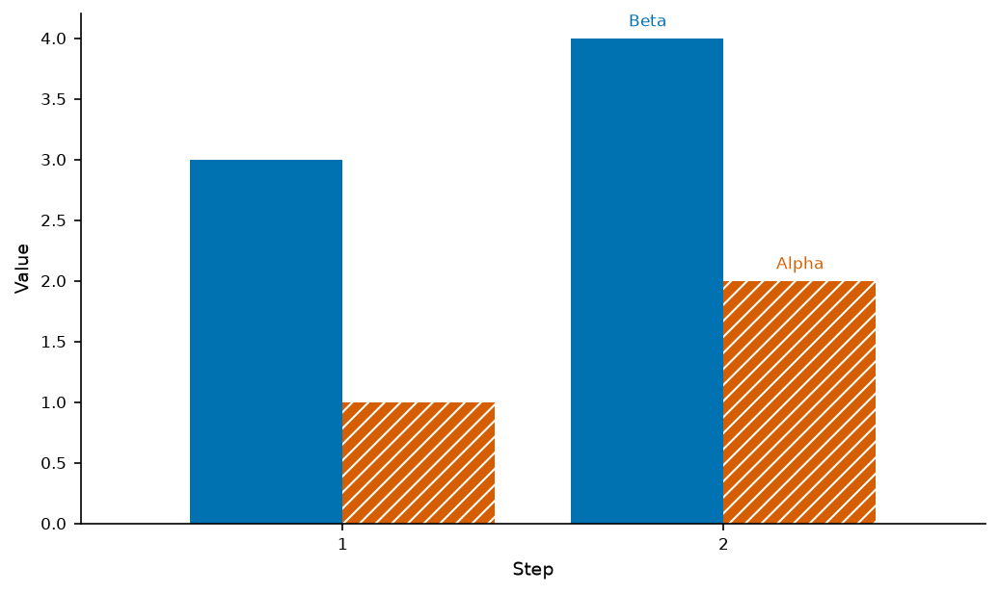

# Direct names identify the plotted quantities

Direct labels previously used the last raw x/y row for several kinds. An ECDF or
survival curve uses a derived probability, a slope uses native category positions,
and a mean curve uses aggregated observations. The old name could therefore be
absent from the export, identify an individual run instead of the mean, or stop
rendering with a category conversion error.

Names now bind to actual source-tagged native artists. Line/point coordinates,
bar value ends and last dumbbell marks retain their source IDs and canonical
alias paths. Scaling names follow the fitted line even when observed points own
the legend handle; calibration reuses each panel's actual ECE suffix. Sparkline
names stay in their child titles without duplicate parent endpoint annotations.
Signed vertical/horizontal bar names sit beyond their actual bar ends. Statistics,
source bytes, original fonts and the existing x-margin policy remain unchanged.

## Actual old/current replay

The [eight-case replay](direct-series-endpoints/strict-replay.json) runs pinned
`9cbd0f6` and current generated programs with identical source bytes, specifications
and an unchanged inspector. All numeric artist coordinates, scales and limits
match. These are controlled synthetic examples, not human usability evidence.

| Context | Original result | Current result |
| --- | --- | --- |
| ECDF and survival | Exit 2; no series names actually drawn | Exit 0; both names drawn at probability endpoints |
| Slope and grouped bars | Exit 1; category conversion error | Exit 0; names use native category/bar positions |
| Inexact fitted curve and panel-specific calibration | Already exit 0 | Still exit 0; fitted endpoint and distinct ECE values retained |
| Sparkline | Exit 0; four names for two child plots | Exit 0; two child-owned names |
| Pooled mean | Exit 0; the out-of-view raw-row name was absent | Exit 0; name drawn on the actual mean |

| Original ECDF export | Native endpoint labels |
| --- | --- |
|  |  |

The original slope/bar programs did not export an image; no before image is
invented for them. The corrected bar export keeps names outside the fill:

The published [training example](../../examples/specs/13-direct-labels.json) now
places names on its mean curves. Of 101 previously tracked PNGs, 100 retain
identical dimensions/pixels; only that example's name positions change. Its
curves/source data remain intact. [Image comparison](direct-series-endpoints/existing-png-comparison.json).

## Controls and limits

`python/tests/test_direct_endpoints.py` has 33 actual native/strict PNG/SVG/PDF
controls: nine endpoint kinds with sparse facets/single plots, independent
probability/normal-quantile/fitted-OLS/pooled-mean expectations, panel ECE values,
child-only names, temporal coordinates, canonical preview targets, signed bar
bounds and retained negative outcomes. Original source bytes/hashes are checked;
actual exported text groups are inspected separately from embedded metadata.

The categorical direct-label warning remains a warning. Unsupported sparkline
repeated metrics remain refused. Authored clipped bars, unfit complete names and
real collisions remain strict failures; endpoint correctness does not promise
that arbitrary wording or coincident endpoints can fit. Complete outside boxes
provide the separately measured [full-name layout](outside-legend-layout.md).

Current/minimum focused controls pass; the combined minimum/fresh offline set
passes 183 controls. Source/fresh editors pass 96 workflows across 21 kinds,
including a real ECDF name click/review/edit/undo with original 01/1 IDs and data
hashes retained. The fresh wheel passes offline installation/Excel/Parquet/editor
controls; all 19 selected product assets match source. Genuine 15 baselines/seven
references/gallery 15 and unchanged frozen 72 NIST outcomes pass. All seven final gates pass on unchanged source/test/fixture files:232 Node and
1,791 Python tests, zero skips and one existing MLflow/SQLAlchemy deprecation.
Ruff check/format pass107 Python files. The new exact commit's main/Figure CI
remains required.

[Source editor](direct-series-endpoints/source-editor-checks.json),
[fresh editor](direct-series-endpoints/installed-editor-checks.json),
[installed assets](direct-series-endpoints/installed-product-matches.json), and
[frozen replay](direct-series-endpoints/certified-replay.json) retain the evidence.
This is source work after immutable PyPI 0.8.0, with no new chart kinds/release.
Long sparkline child headings, long table context/headers, full 83 acceptance and
84–89 remain open.

[Final verification](direct-series-endpoints/verification.json),
[seven gate receipts](direct-series-endpoints/local-gates.json), and
[tested source hashes](direct-series-endpoints/tested-source-manifest.json) bind
the local results. The earlier full1790 run passed before the additional pooled-mean
control; the final1791 run includes it. The initial browser helper used a nonexistent
target bbox field; corrected normalized bounds are exercised in both passing
96-workflow runs. Product endpoint code remained unchanged during final checks.
