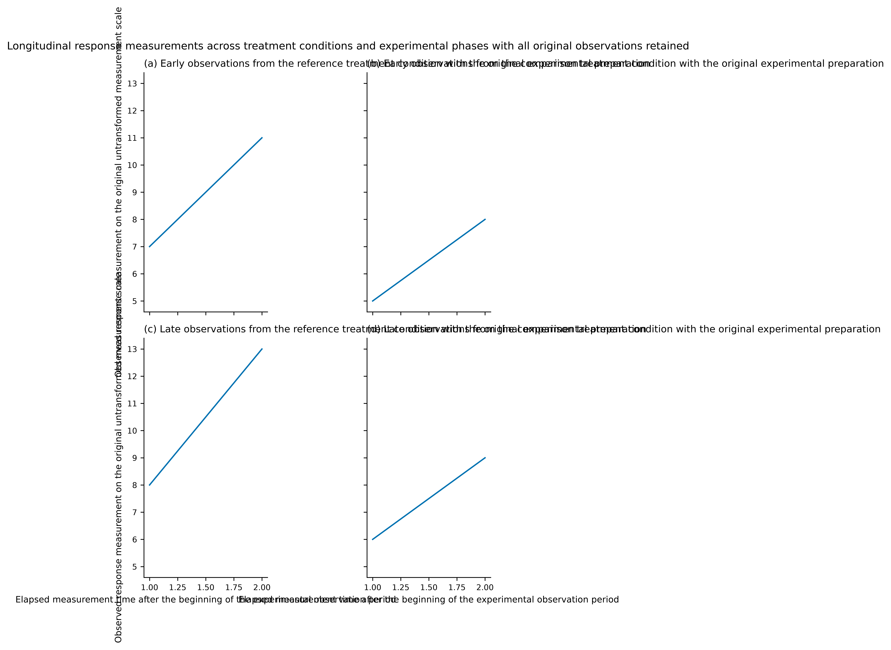
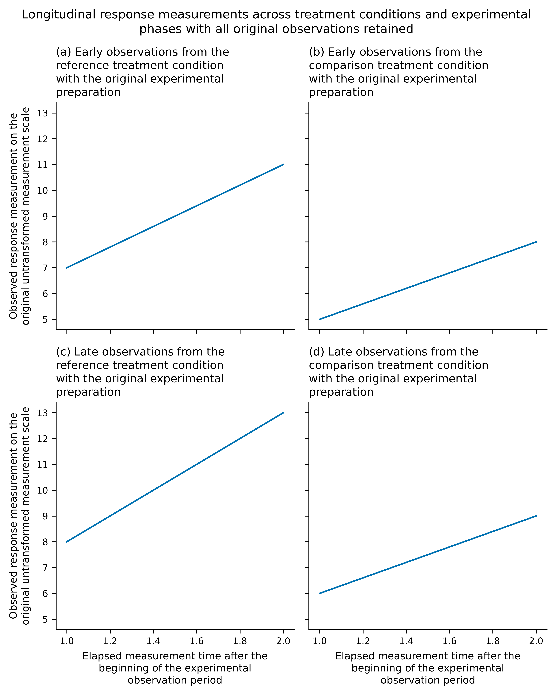

# Complete measured plot headings: checkpoint83e2

Long plot titles, nested panel headings and axis labels now wrap using actual
font measurements. The renderer keeps every word, unit, source identity and
automatic panel letter. Math expressions stay together, and complete identifiers
remain intact. Canonical JSON wording is unchanged by visual line breaks.

| Before: overlapping headings and export too wide | After: complete wording within the column |
| --- | --- |
|  |  |

The same synthetic eight-row input and canonical specification were executed
with the real translator at12763f8dddecbb9fe99a8bae6516c870e39f33d8 and the
initial heading checkpointc02c43f. Before: strict exit2, `labels_collide` and `text_too_small`. After: exit0;
the existing `line_implies_continuity` advisory remains. Both retain spec hash
`e37320ed475892fc` and data hash prefix `9f604c94773850b6`.
[Inputs](heading-layout/inputs.json), [measurements](heading-layout/measurements.json)
and actual reports are stored beside the images. PNG, SVG and PDF were exported.

Fitting starts before tight layout can squeeze the data axes. Measured text and
axis decoration bounds budget extra figure height when necessary, retaining the
column width and original data-panel height. Later passes wrap only text that
still overflows. Font sizes are retained. Visual inspection caught an early
single-column result that passed the verifier but left almost no data-panel
height; the current fixture additionally checks the actual data area.

`python/tests/test_heading_layout.py` exercises native observations and strict
reports for nested panels, single-column output, repeated metrics, horizontal
bars, declared units and math expressions. Deliberately clipped bars, false
claims and a long unbreakable identifier stay blocked. The preview test checks
that wrapped targets retain canonical paths, original nested keys and complete
wording. The raw inspector's actual exported-width and font-floor checks stay
unchanged. Its generated-title controls now distinguish repaired prose from an
unbreakable identifier that still fails the real font floor.

`scripts/preview-headings-check.ts` performs six actual editor workflows: render,
click a wrapped heading, review/apply a wording change, undo, edit a wrapped axis
on a narrow viewport and undo again. Manual mode still forces strict rendering;
original CSV hashes, values, fields, units and panel letters are preserved.
This is part of `npm run preview-check`.

The implementation is `src/codegen/heading-layout.ts`, integrated into ordinary
plot and broken-axis generation in `src/codegen/index.ts`. Outside-box legends
and table context have their own layout paths and remain part of the next83
checkpoint. Their unused heading helper is omitted from generated scripts.
Full83 acceptance and84–89 remain open. These changes follow the immutable
published0.8.0 release; no new release or tag is created here.

## Initial83e2 verification

All seven gates pass on stable source/test files:234 Node/1656 Python tests,
zero skips/one existing upstream MLflow/SQLAlchemy warning.48 heading/export
controls pass on current/minimum Python;10 focused heading controls pass from
the fresh installed wheel. Source/fresh offline editors each pass90 workflows
across21 kinds, including18 diagnostics and6 wrapped-text cases, with zero
JavaScript errors/external browser requests. Actual minimum-Python6 editor
cases also pass;19 installed assets byte-match source.

The translator was rebuilt, all15 baselines and7 reference programs genuinely
regenerated, and gallery passes15/15.80 of81 existing PNGs retain identical RGBA
pixels/dimensions; the seed-spread graphic intentionally wraps its long y-label
unit onto another line. Its before/after image was visually inspected.
The single-column fixture retains [2.032in of data height against a2.002in
original budget](heading-layout/single-column-data-area.json), at unchanged
3.4in figure width. See [verification](heading-layout/verification.json) and
adjacent browser/installation/image JSON. Exact new-commit CI must pass before
advancing to the next checkpoint. These are automated controls, not blind human
judgments or a productivity comparison.

The initial c02c43f main CI subsequently failed exact publisher-label checks;
see the [available-margin correction](heading-margin-regression.md) and its
unchanged frozen72-run replay. The original image/verification snapshots above
remain historical evidence of that checkpoint.
