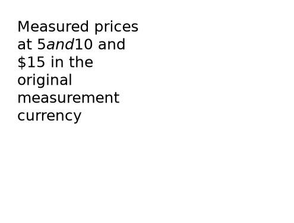
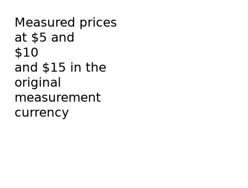
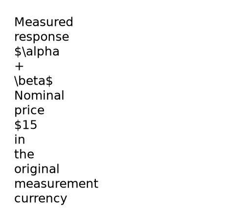
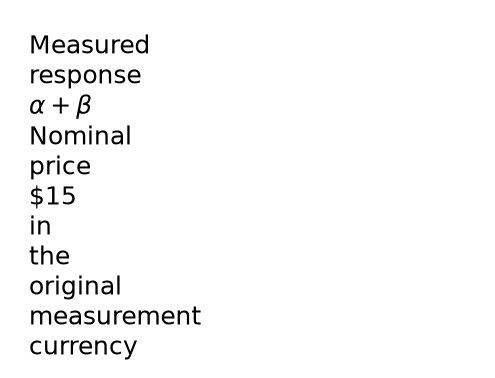

# Preserve native literal and math context when wrapping headings

Keeping the raw title words is insufficient. Matplotlib decides whether each
line contains math. Wrapping a literal title with three currency signs could
produce a line with two signs, turn those signs into math delimiters, and remove
them from the visible figure. A formula paragraph followed by an authored
literal-currency paragraph could instead lose its intended formula rendering.

The owned heading wrapper now measures and preserves each original paragraph's
native interpretation. It protects complete math spans and keeps originally
literal currency lines literal. An unbreakable dollar-pair word stays with an
odd-dollar neighbor within the same authored paragraph. Complete wording, font
size, parsing flags, source identities, canonical intent and data remain intact.
The ordinary strict checks still reject wording that cannot fit; malformed math
still fails rather than being escaped into a successful result.

Actual generated-code images show the regression and correction:

| Case | Before | After |
| --- | --- | --- |
| Literal currency |  |  |
| Formula then literal paragraph |  |  |

[Measurements](heading-literal-context/measurements.json) record the actual SVG
glyphs and unchanged raw words. These are synthetic typography probes, not
scientific acceptance or evidence of researcher adoption.

## Verification

The new native module covers 45 SVG contexts, two strict generated PNG/SVG/PDF
exports with original CSV hashes and canonical titles, and malformed-math
rejection. All 99 combined heading/export controls pass on Python 3.12 with
Matplotlib 3.11, minimum Python 3.10 with Matplotlib 3.10, and the fresh installed
wheel. SVG outline IDs use Unicode codepoints in the older backend and glyph
indices in the newer one. The export tests independently render each expected
glyph with the same publication fonts and count actual uses of its backend ID;
they do not assume a fixed hexadecimal codepoint or change the product SVG mode.

All seven required gates pass on unchanged source/test files: 234 Node tests,
1,707 Python tests, zero skips and one existing upstream deprecation warning.
Source and fresh offline installed editors each pass 90 workflows across all
21 kinds, including six heading and 18 diagnostic controls, with no JavaScript
errors or external browser requests. All 19 installed product assets match.

All 15 baselines and seven references were genuinely regenerated; the gallery
passes 15/15. All 85 existing PNGs retain identical dimensions and pixels;
provenance metadata changes where the generated program changed. The unchanged
frozen NIST protocol passes all 72 expected outcomes: each arm accepts 18 clean
runs and rejects 18 missing-interval controls with zero execution failures.
These are nine datasets with repeated variants and exports. No new authoring
time or independent benchmarking claim is made.

[Verification receipt](heading-literal-context/verification.json),
[gate receipts](heading-literal-context/local-gates.json),
[tested source hashes](heading-literal-context/tested-source-manifest.json),
[source editor](heading-literal-context/source-editor-checks.json),
[installed editor](heading-literal-context/installed-editor-checks.json), and
[NIST replay](heading-literal-context/certified-replay.json) preserve the local
evidence. The regression cases live in
`python/tests/test_heading_literal_context.py`; run them with the documented
Python test environment and `PYTHONPATH=python python -m pytest -q`.

This correction follows accepted margin checkpoint `d404a7e`. Its new exact
commit must pass main and Figure CI before advancing. Outside legends, table
context, full task 83 acceptance, and tasks 84–89 remain open. This source work
has not been published as a new PyPI release.
