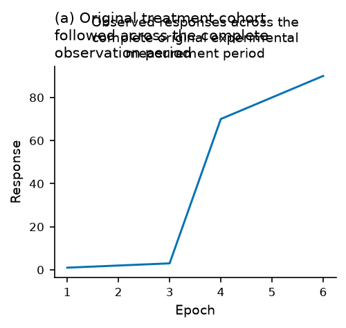
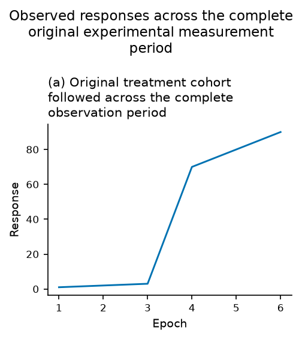
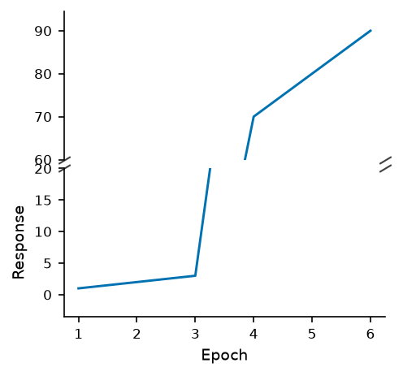
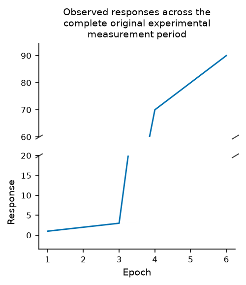

# Keep global titles separate from panel headings

A facet with one observed panel used the axes' center title for the global
heading while its panel heading occupied the same area. Long titles overlapped.
The broken-axis branch omitted the requested title and fixed its inter-panel
gap too tightly for the tick labels at the join.

Facet figures now give the global heading its own figure title even when only
one panel is observed. The panel keeps its complete alias, automatic letter and
original facet identity. Broken-axis figures put the title on the upper axes.
Their layout clears the fixed gap override so the native engine can measure
both sets of ticks, then budgets height to retain the original data-panel
heights. Neither the cut bounds nor any observations change.

| Original source at `4cfdf9d` | Corrected layout |
| --- | --- |
|  |  |
|  |  |

The [strict replay](heading-ownership/strict-replay.json) uses actual old/current
bundles and identical original six-row CSVs and complete wording. Both old cases
exit 2; both corrected cases exit 0 and write PNG/SVG/PDF. Actual artist
[before](heading-ownership/before-measurements.json) and
[after](heading-ownership/after-measurements.json) measurements retain their
context identities. These are synthetic regression examples, not a scientific
validity or human usability study.

Fourteen new native controls cover short, long and mixed math/literal headings,
automatic letters on/off, no invented title when absent, original cut bounds,
actual numeric marks, data-panel heights, repeat layout in the same publication
RC context, unbreakable-title strict failures, and actual preview geometry.
`python/tests/test_heading_ownership.py` preserves the replay inputs and checks.
The browser tests click the actual title, load canonical wording, review/apply a
strict manual edit, retain the source data and panel/cut identity, and undo it.

All seven checks pass on unchanged source/test files: 234 Node and 1,721 Python
tests, zero skips and one existing upstream deprecation warning. All 113
heading/export controls pass on minimum Python 3.10 and the fresh installed
wheel, and are included in the passing current full suite. Source/fresh offline
editors each pass 92 workflows across 21 kinds, including eight heading and
18 diagnostic cases. Minimum Python also passes the eight heading browser
workflows. No JavaScript errors or external browser requests occur; 19 installed
product assets match the source.

All 15 baselines and seven maintained references were genuinely regenerated;
gallery passes 15/15. All 89 existing PNGs retain their original dimensions and
pixels. The unchanged frozen NIST comparison passes 72 expected outcomes from
nine datasets and repeated variants/exports. Each arm accepts 18 clean runs and
rejects 18 missing-interval controls with zero execution failures. Historical
benchmark results and clocks are unchanged.

[Verification](heading-ownership/verification.json),
[gate receipts](heading-ownership/local-gates.json),
[source hashes](heading-ownership/tested-source-manifest.json),
[installed editor](heading-ownership/installed-editor-checks.json),
[minimum browser](heading-ownership/minimum-heading-checks.json) and
[NIST replay](heading-ownership/certified-replay.json) preserve the evidence.
The preceding literal/math checkpoint `4cfdf9d` passed exact
[main](https://github.com/unluckyjet/GraphUnslopify/actions/runs/41104445012) and
[Figure](https://github.com/unluckyjet/GraphUnslopify/actions/runs/41104445231) CI
before this implementation began. Heading ownership3f2a925 subsequently passed
exact [main](https://github.com/unluckyjet/GraphUnslopify/actions/runs/41110332003)
and [Figure](https://github.com/unluckyjet/GraphUnslopify/actions/runs/41110331832)
CI before outside-legend implementation. Downloaded
[NIST evidence](heading-ownership/ci-certified-summary.json) confirms72 expected
outcomes; [editor evidence](heading-ownership/ci-editor-checks.json) confirms92
workflows/8 headings/18 diagnostics with zero JavaScript errors/external requests. Outside legends, long table context/headers,
full task 83 acceptance and tasks 84–89 remain open. No new PyPI release is made.
