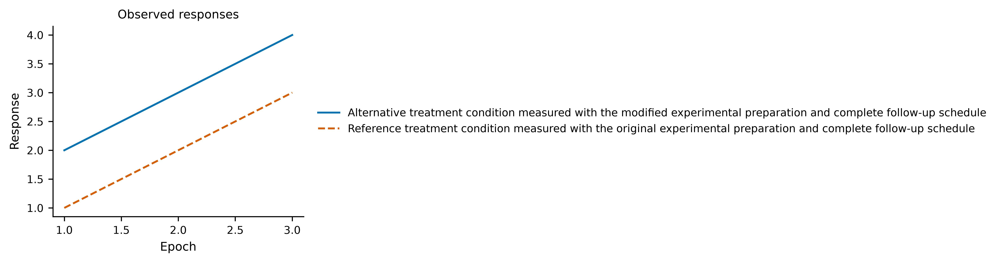
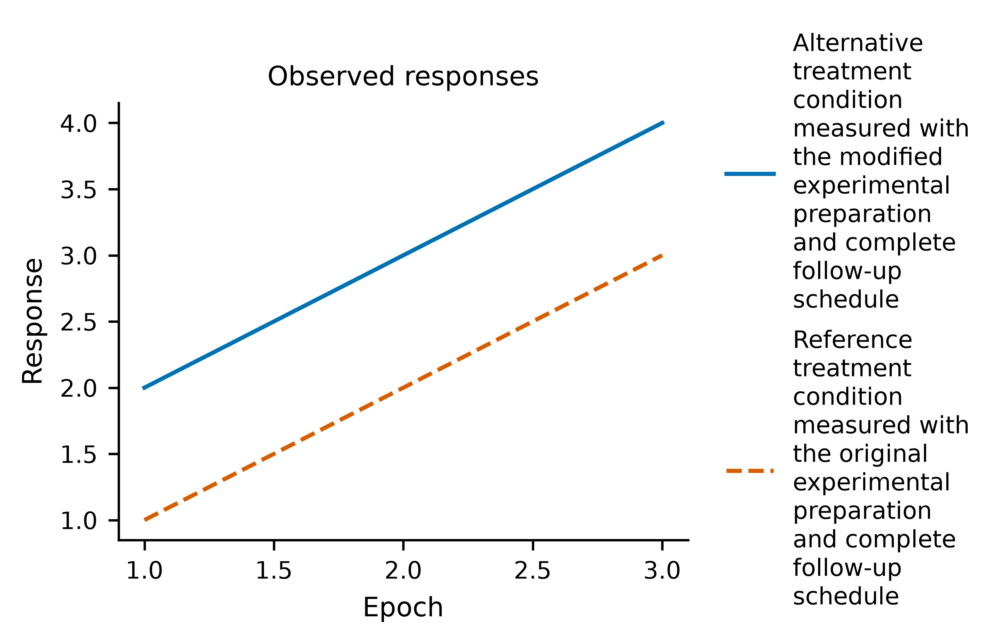
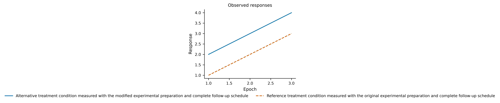
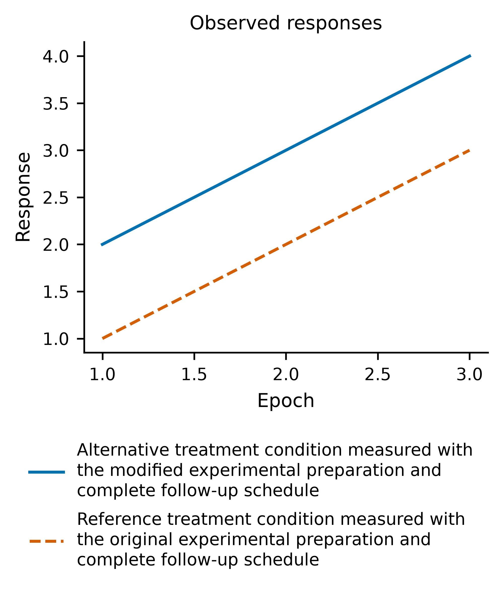
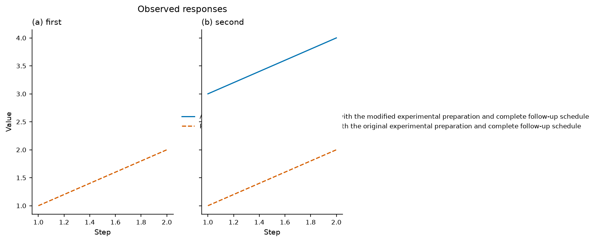
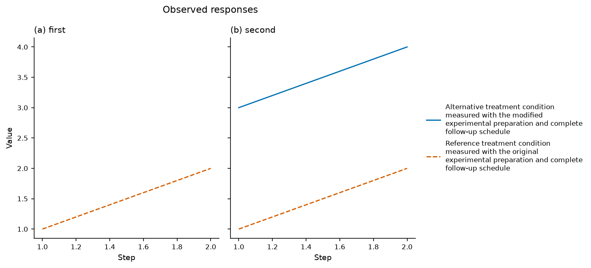
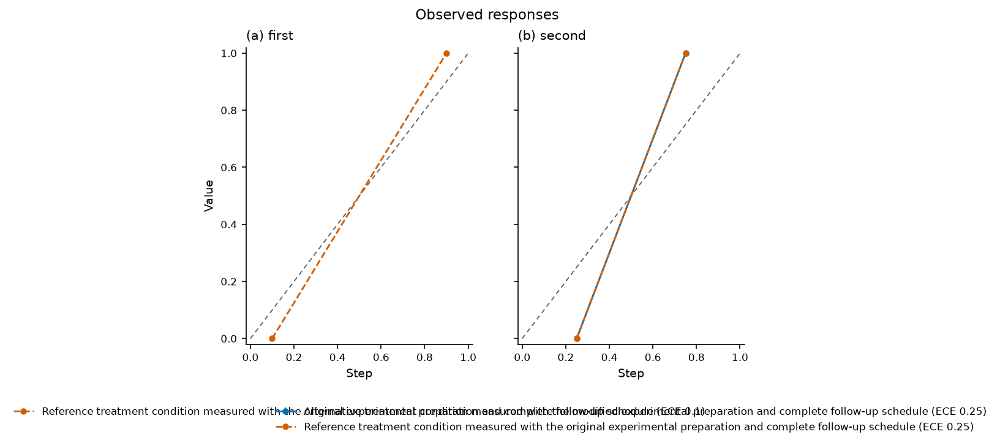
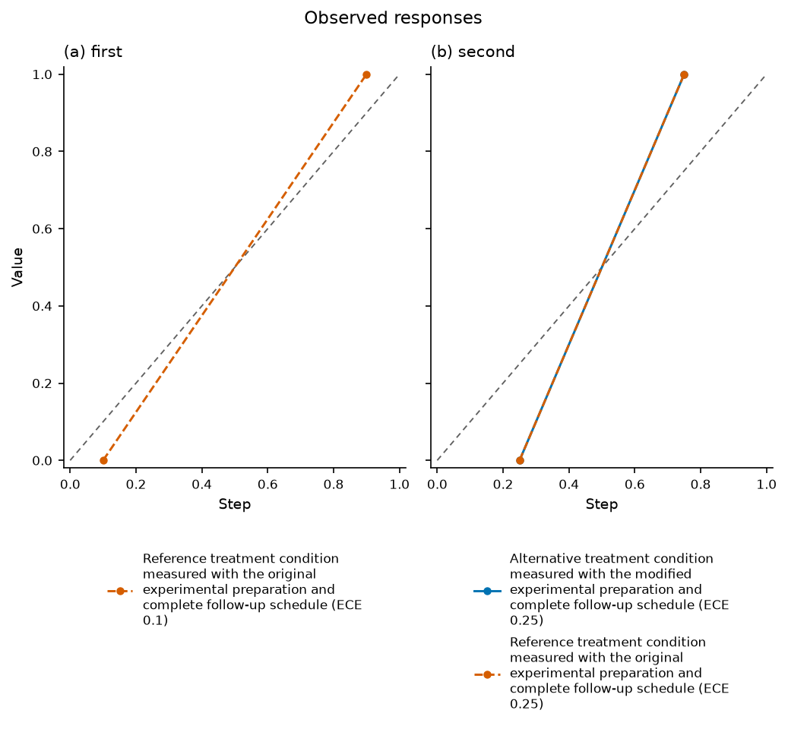

# Fit complete outside legends around their actual owners

Long source names could expand a tight export until its text became unreadable
at manuscript width. A shared legend anchored to the first subplot could extend
over another panel, while long calibration entries could collide across panels.

The formatter now measures actual legend text and keeps complete names, titles,
fonts, parsing flags, source bindings and computed suffixes. It compares native
column layouts before wrapping: short entries retain a horizontal strip when it
fits, and four short entries can use a compact two-row arrangement. Full words
and formula spans use the existing literal/math context guard.

Ordinary shared legends sit beyond the complete panel grid. They retain their
axes ownership so existing inspection and editable source targets continue to
apply. Calibration legends stay panel-local, with each panel's own ECE values.
Native layout reserves heading and legend space, including when short headings
need no wrapping. Height budgeting preserves the original data area without
compounding fixed text margins into an unnecessarily tall plot.

| Original source | Corrected layout |
| --- | --- |
|  |  |
|  |  |
|  |  |
|  |  |

The [actual old/current replay](outside-legend-layout/strict-replay.json) uses
historical bundle `3f2a925`, the current bundle, identical original synthetic
CSVs, complete wording and genuine strict PNG/SVG/PDF execution. Original numeric
artists, scales and limits match exactly. The two narrow examples and calibration
example change from exit 2 to 0. The old wide shared-right example already exited
0 while its legend overlapped another data axes region; the corrected example
still exits 0 and its measured legend clears that region. This is an owned-layout
improvement, not a claim that the old verifier detected every visual problem or
that the overlap necessarily covered a particular data point.

## Controlled checks

`python/tests/test_legend_layout.py` preserves 37 native controls: both outside
positions across ten boxed-legend kinds, the original narrow six-row examples,
compact short labels, distinct panel ECE values, nested/repeated/broken-axis,
layer and temporal contexts, long titles, actual currency/formula SVG glyphs,
canonical preview targets and strict negative evidence. Grouped secondary axes
remain explicitly unsupported. Layout checks compare actual numeric artists,
view bounds, canonical identities, fonts, parsing flags and data-panel heights.
The controlled calibration examples also bound excess data-area growth.

The browser controls click wrapped source names, load complete canonical text,
review/apply aliases in manual mode, retain original IDs/data hashes/panel
statistics, and undo. An unbreakable alias still fails with review downloads;
undo and a strict rerender recover. These controls extend the existing editor
suite; they do not establish general human usability or blind visual quality.

Two earlier source-string tests assumed fixed columns and prohibited every
`tight_layout` call. Actual native geometry and preserved negative outcomes now
cover those requirements. The formatter temporarily excludes a shared legend
from native space calculation and restores its layout participation before
export, so tight cropping and final-PNG geometry include the actual legend.

The frozen NIST protocol, evaluator and producers are unchanged. Its repeated
variants and exports represent nine datasets, not independent human evaluation
or a new timing study. Ordinary strict checks retain acceptance authority;
arbitrary unbreakable text or constrained layouts can still fail.

This is source work after the public PyPI 0.8.0 wheel. Its new exact commit must
pass all main jobs and Figure CI before the next implementation. Sparkline child
headings, long table context/headers, full task 83 acceptance and tasks 84–89
remain open. No new chart types or PyPI release are added.

## Final local verification

All seven required checks pass on unchanged source/test files:232 Node tests and
1,758 Python tests, zero skips and one existing upstream deprecation warning.
The150 combined heading/legend/export controls pass on minimum Python3.10 and
the fresh offline wheel and are included in the passing current full suite.
Source/fresh editors each pass95 workflows across21 kinds, including8 headings,
18 diagnostics and3 legend workflows; the minimum runtime also passes the three
legend browser workflows. No JavaScript errors or external browser requests
occur. All19 installed assets match source bytes.

All15 baselines and7 maintained references were genuinely regenerated; gallery
passes15/15. Of93 existing PNGs,86 retain identical dimensions/pixels and seven
change for measured legend/space placement. All seven changed final exports were
visually reviewed. The unchanged72-case NIST replay passes every expected outcome:
each arm accepts18 clean runs and rejects18 missing-interval controls with zero
execution failures.

[Verification receipt](outside-legend-layout/verification.json),
[seven gate receipts](outside-legend-layout/local-gates.json),
[tested source hashes](outside-legend-layout/tested-source-manifest.json),
[source editor](outside-legend-layout/source-editor-checks.json),
[installed editor](outside-legend-layout/installed-editor-checks.json),
[minimum browser](outside-legend-layout/minimum-legend-checks.json),
[installed assets](outside-legend-layout/installed-product-matches.json),
[image comparisons](outside-legend-layout/existing-png-comparison.json), and
[frozen replay](outside-legend-layout/certified-replay.json) preserve the evidence.
Exact new-commit CI remains required before the next implementation.
