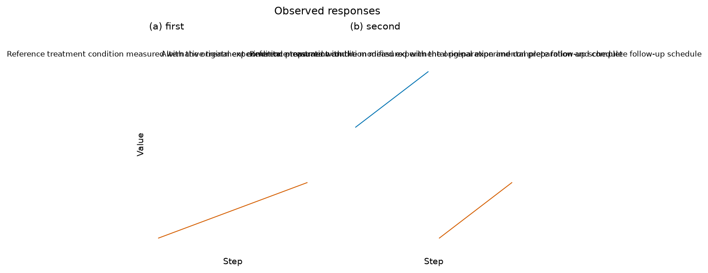
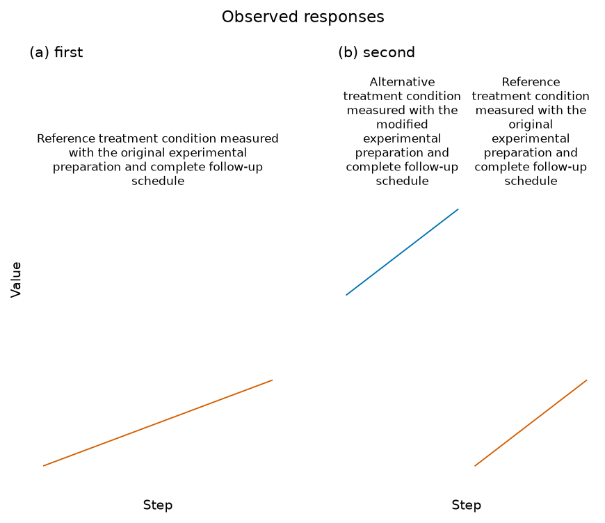
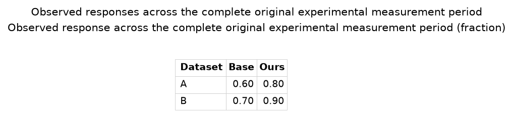
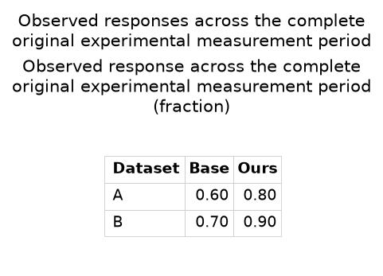
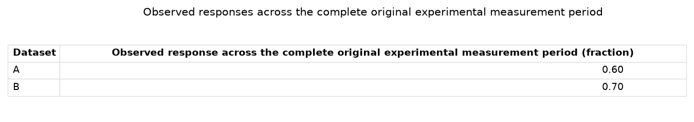
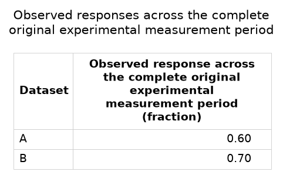

# Fit complete child headings and table context

Full sparkline source names overlapped across child plots. Long table context or
headers widened tight exports enough to make their text unreadable at manuscript
width. The original source words and data are retained in the
[actual inputs](owned-text-layout/inputs.json).

Sparkline headings now use native font measurements and the existing literal/math
wrapper. Corresponding child rows reserve measured title space while retaining
the original physical data height, shared ranges, numeric points, fonts and source
targets. Public draw-time locators follow the owning axes through resizing and
cropping. Other inset axes retain their own locators. Unnecessary fitting leaves
short examples intact.

Table layout accepts artists rather than observations/estimators. It wraps complete
literal context, headers and row names while reserving immutable numeric/interval
strings. Physical row padding, units, winner styling and original fonts remain.
Measured numeric-grid width centers the complete table without introducing an
oversized invisible axes boundary into the tight export. Markdown/TeX output is
unchanged. Short tables return before layout changes.

## Original failures, measured again

| Original export | Complete wording with measured space |
| --- | --- |
|  |  |
|  |  |
|  |  |

The [actual pinned/current replay](owned-text-layout/strict-replay.json) compares
`d7e32f0` with the new bundle on identical source bytes/specifications and the
unchanged inspector. All three change from strict exit2 to0. Effective export
text scale changes0.671/0.502/0.378 to1.0, with original fonts and complete words.
Sparkline point coordinates/scales/limits/data heights remain; table quantities
and complete Markdown/TeX bytes match. These are controlled examples, not human
productivity or independent adoption results.

All115 previously tracked PNGs retain identical dimensions/pixels. Genuine
regeneration refreshes the table/sparkline reference provenance fingerprints;
no image metadata is patched by hand. [Comparison](owned-text-layout/existing-png-comparison.json).

## Verification and boundaries

25 native controls cover original/single/nested/direct/column/parent-heading
contexts, renderer-owned text identity, font/parser preservation and data heights,
independent means/units/SEM intervals, actual currency/Greek glyphs, literal table
formula extraction, strict false claims and unfit wording/column negatives. Other
inset ownership is explicit; the supported native InsetIndicator accessors replace
deprecated tuple unpacking without changing its numerical region.

The earlier breakable12-repeat oversized-title test now verifies all original
words in actual PDF output, headers and full text scale. Separate unbreakable and
many-column cases still fail the actual font floor. No source is shortened and
no data/quantity/verification gate is weakened.

Source/fresh editors pass101 workflows across21 kinds, including five new actual
child-name/form/undo/failure/recovery cases. Minimum/fresh native batches pass236
controls. Fresh offline wheel installation/Excel/Parquet/editor controls and19
source asset matches pass. Genuine15 baselines/seven references/gallery15 and the
unchanged frozen72 NIST expected outcomes pass. All seven final gates pass232 Node/1,816 Python tests with zero skips and one
existing MLflow/SQLAlchemy deprecation; Ruff108 passes. New exact-commit
main/Figure CI remains required.

[Source editor](owned-text-layout/source-editor-checks.json),
[fresh editor](owned-text-layout/installed-editor-checks.json),
[installed assets](owned-text-layout/installed-product-matches.json), and
[frozen replay](owned-text-layout/certified-replay.json) retain the evidence.

Arbitrary unbreakable text, constrained many-column tables, coincident direct
labels and dense foreign insets can remain failed. No universal automatic layout
or source-free scientific certification is claimed. Full83 acceptance and84–89
remain open; this source work does not publish a PyPI release or add chart kinds.

[Final verification](owned-text-layout/verification.json),
[seven gate receipts](owned-text-layout/local-gates.json),
[tested source hashes](owned-text-layout/tested-source-manifest.json), and
[minimum browser](owned-text-layout/minimum-browser-checks.json) bind the results.
The minimum real browser separately passes all five new workflows with no JS
errors or external requests. The complete source/test/fixture set stayed unchanged
during final required checks.
