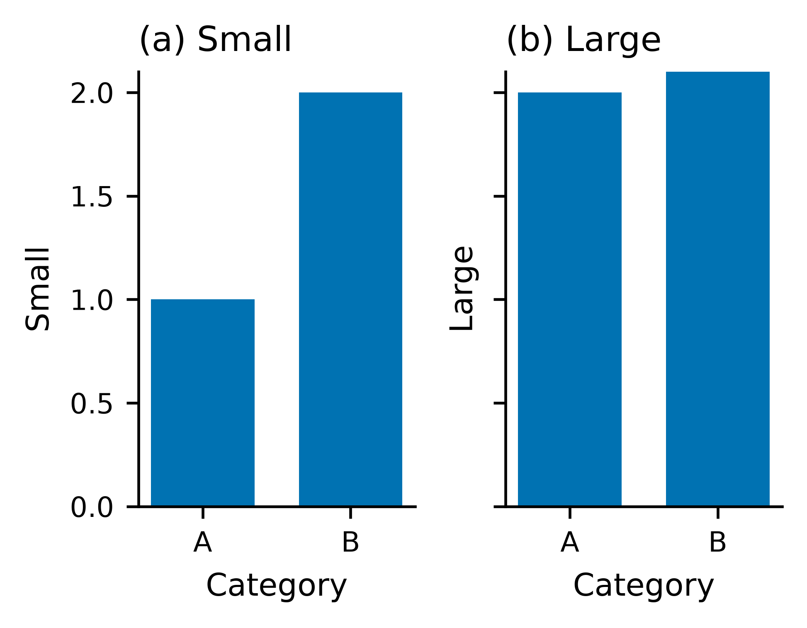
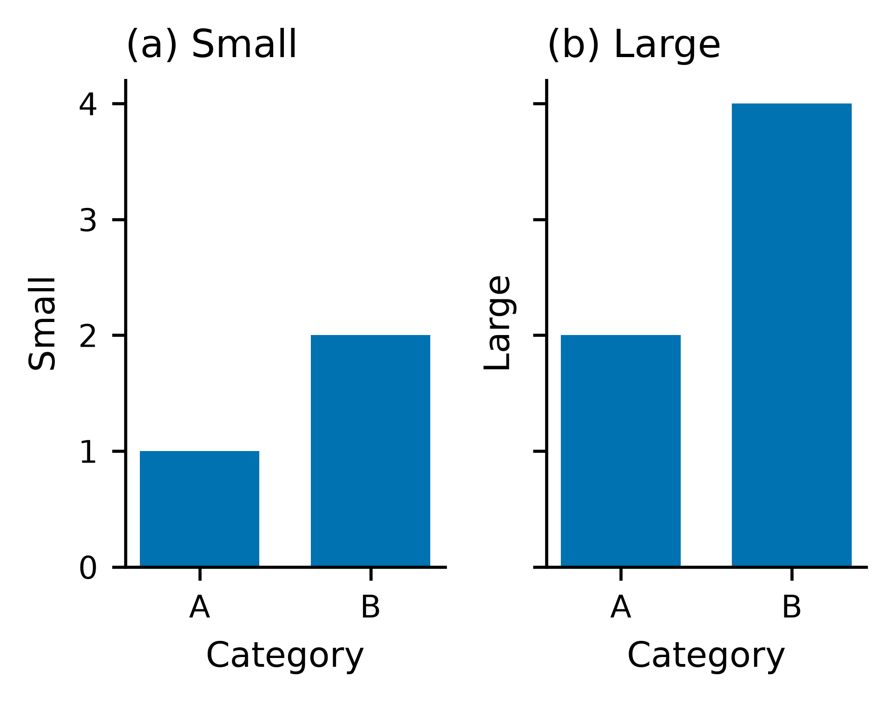

# Shared automatic bar ranges: checkpoint83a

The first panel's zero-baseline adjustment used `set_ylim`/`set_xlim` with their
default `auto=False`. In a shared group, that disabled autoscaling before later
panels supplied their data. Preserving the existing state with `auto=None` lets
Matplotlib extend automatic ranges, while subsequent authored limits keep their
existing effect. See the [Matplotlib API](https://matplotlib.org/stable/api/_as_gen/matplotlib.axes.Axes.set_ylim.html).

## Actual before/after

Both panels use the same input CSV and canonical specification in each pair.
The actual bars are `[1,2]` and `[2,4]`; no value limits were supplied. Before,
both y ranges were0..2.1 and strict verification failed with `bar_mark_clipped`.
After, both ranges are0..4.2 and strict verification passes. The pre-existing
`unaggregated_bar` warning remains visible in these original fixtures.

| Before: later values clipped | After: complete shared range |
| --- | --- |
|  |  |

These are synthetic coordinate controls, not research results. The same failure
and repair were measured in vertical facets. Horizontal repeats remain
unsupported and are excluded from acceptance. Exact data hashes, unchanged spec
hashes, strict reports and measured artists are in
[measurements.json](shared-bar-range/measurements.json) and its neighboring reports.

## Regression scope

`python/tests/test_shared_bar_limits.py` runs actual strict generated scripts and
replays their actual Matplotlib artists. Its17 cases cover supported vertical
repeats and both facet orientations; positive/negative values; independent
unshared ranges; unchanged deliberate0..3 clipping; interval endpoints
`[1,2]/[2,3]` and `[3,5]/[4,6]`; and stacked endpoints up to8.

All17 pass on Python3.10.22 and3.12.14, and from a fresh installed source wheel
with external product connections blocked. Source/fresh-installed browser checks
each pass66 workflows across21 native kinds, with0 JavaScript errors and0
external browser requests. The model cases use a controlled provider; this run
does not add live-model or human-quality evidence. The14 installed product assets
match current source bytes. See the adjacent browser and installation JSON files.

The translator was rebuilt, all15 committed baselines and7 reference programs
were genuinely regenerated with the explicit Python environment, and gallery
verification passes15/15. All73 pre-existing tracked PNGs retain identical RGBA
pixels/dimensions; three contain refreshed provenance bytes. The new synthetic
before/after pictures intentionally differ. See
[the PNG audit](shared-bar-range/published-png-audit.json).

All seven required gates pass with stable source/test files:234 Node and1582
Python tests,0 skips/1 existing upstream MLflow/SQLAlchemy warning. See
[verification.json](shared-bar-range/verification.json). Exact new-commit CI is
checked after this checkpoint is pushed.
This checkpoint is part of83. Spatial overlays, panel-aware duplicate warnings,
measured owned layout, and the full84–89 roadmap remain open. These changes are
source-only after the published0.8.0 release; no release/tag is created here.
