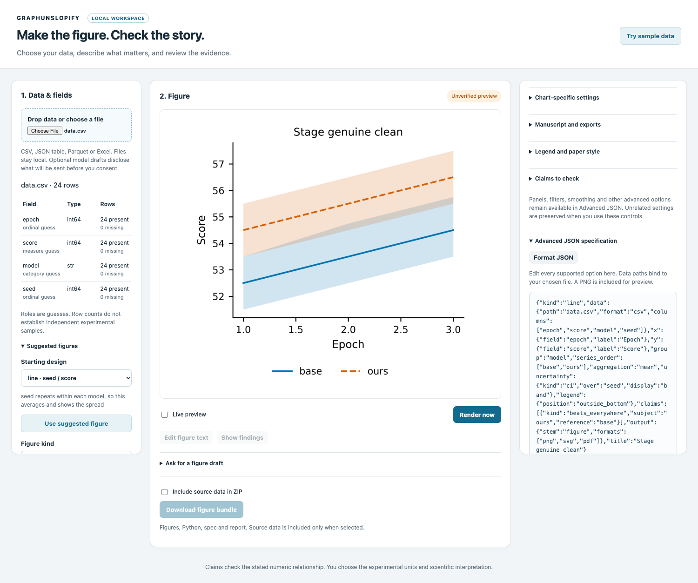
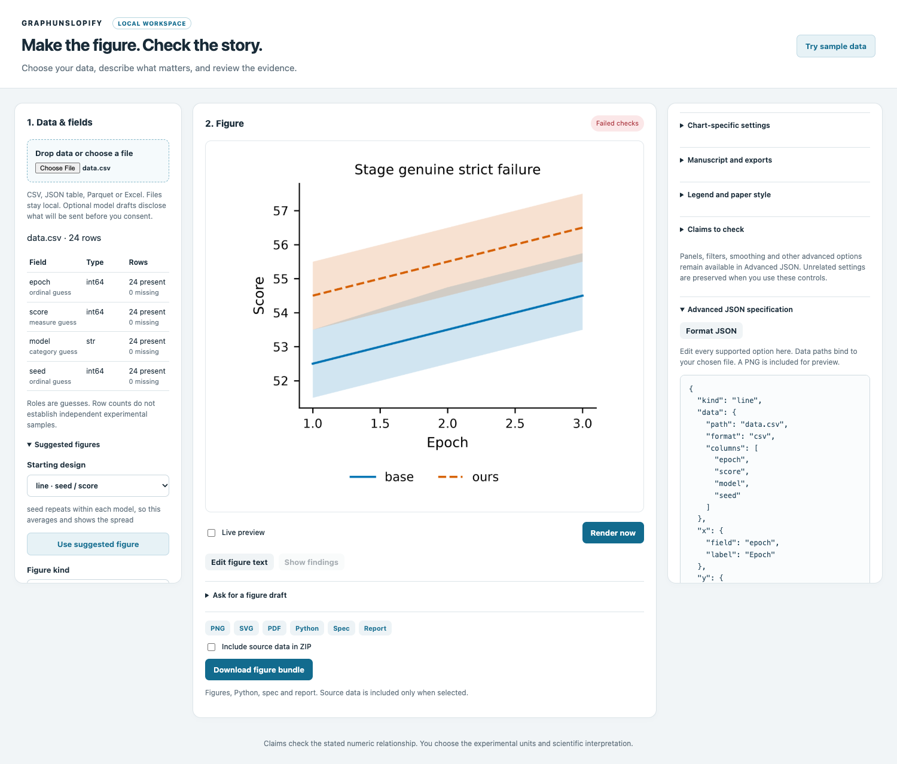

# Unverified preview and final checks

Current source can display the actual figure while its checks and requested
exports finish. The early image is labelled **Unverified preview**. Download
links, bundle export and diagnostic/text targets remain unavailable until the
current final response arrives. Editing the intent immediately discards the
early image; late responses or image decoding cannot restore an older result.

The original strict script runs once. A failed claim still ends with failed
checks and its current report; an early image is never a certificate. Progress
can be unavailable or arrive too late to be useful, in which case the final
result is shown normally. Public PyPI0.8.0 predates this source feature.

This is a controlled correctness test using the original24-row fixture. The
genuine checker is deliberately held and then released; the screenshot does not
measure ordinary preview latency. The actual current PNG has already been saved,
while final scientific acceptance has not completed.

## Current evidence and limits

Source107 browser workflows (the existing101 plus six staged cases) and six
controlled minimum-Python workflows pass. The new cases exercise genuine
pre-check availability, original strict failures, late metadata/image decoding,
live-off invalidation and refusal of malformed progress acceptance. Existing
source/claim/undo/draft/consent and export checks remain in the complete suite.
Fresh107 GUI and all60 packaged files also pass outside the checkout. Seven
stable checks pass232 Node/1904 Python/zero skips/one upstream warning, Ruff152
on419 unchanged source/test/fixture files. Push/exact new CI remains pending.

The [frozen comparison](../../benchmarks/staged/protocol.json) separately measures
first image and final result, including extra copy/hash/transport/decode work,
original negatives and a PNG-only control. Its612 formal/108 smoke records are
unmeasured so far. No general speed or human usability gain is established by
controlled holds. [Backend/methods](../../benchmarks/staged/README.md);
[full scope](../../pipeline/specs/85-incremental-staged-preview.md).
